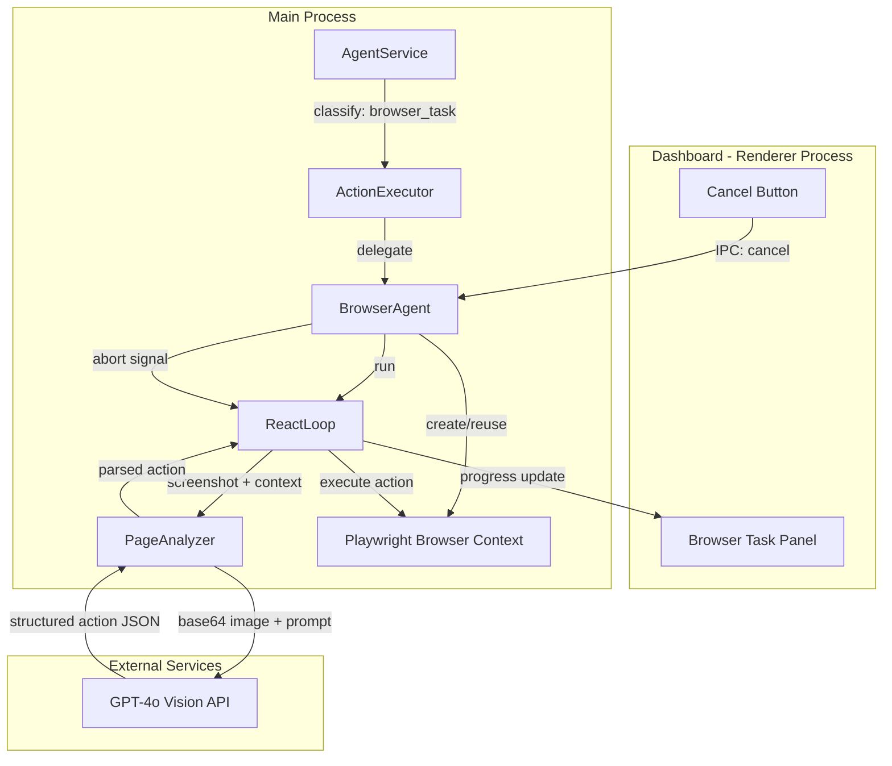

# Design Document: Browser Agent

## Overview

This feature extends the existing voice AI agent with autonomous browser automation. When the `IntentClassifier` detects a "browser_task" intent (multi-step web interaction), the `ActionExecutor` delegates to a new `BrowserAgent` module. The `BrowserAgent` manages a persistent Playwright Chromium instance and executes tasks via a ReAct (Reason + Act) loop powered by GPT-4o vision.

The core flow:
1. User voice command → `CommandDetector` → `IntentClassifier` classifies as `browser_task`
2. `ActionExecutor` delegates to `BrowserAgent.executeTask(command, abortSignal)`
3. `BrowserAgent` launches/reuses a persistent Playwright browser context
4. `ReactLoop` iterates: screenshot → GPT-4o vision → parse action → execute action → repeat
5. Progress updates stream to the Dashboard via IPC
6. Task completes with result, or is cancelled/times out

Key design decisions:
- **Playwright persistent context** with user data dir in `app.getPath('userData')/browser-data` for session persistence
- **GPT-4o vision** receives base64 screenshots at 1280×720 for page understanding
- **Max 15 iterations** per task to prevent runaway loops
- **AbortController** for cancellation with <2s acknowledgment
- **Headed by default** so users can watch; headless available in settings
- **Login detection** pauses the task and notifies the user

## Architecture



### Module Responsibilities

| Module | Responsibility |
|--------|---------------|
| `BrowserAgent` | Lifecycle management of Playwright browser, task orchestration, IPC communication |
| `ReactLoop` | ReAct cycle execution (plan → act → observe → decide), iteration limiting |
| `PageAnalyzer` | Screenshot capture, GPT-4o vision API calls, response parsing |
| `ActionExecutor` (extended) | Routes `browser_task` intent to `BrowserAgent` |
| `IntentClassifier` (extended) | Detects `browser_task` vs `open_url` based on interaction verbs |

## Components and Interfaces

### BrowserAgent (`browser-agent.ts`)

```typescript
import { BrowserContext, Page } from 'playwright';

export interface BrowserTaskRequest {
  command: string;
  taskId: string;
}

export interface BrowserTaskResult {
  taskId: string;
  status: 'completed' | 'cancelled' | 'failed' | 'partial';
  result?: string;
  structuredData?: Record<string, unknown>;
  stepsCompleted: number;
  error?: string;
  confidence?: number;
}

export interface BrowserAgentConfig {
  userDataDir: string;
  headless: boolean;
  viewport: { width: number; height: number };
  maxSteps: number;
  apiKey: string;
}

export class BrowserAgent {
  private context: BrowserContext | null = null;
  private page: Page | null = null;
  private config: BrowserAgentConfig;
  private reactLoop: ReactLoop;
  private isRunning: boolean = false;

  constructor(config: BrowserAgentConfig, notifier: BrowserTaskNotifier);

  /** Execute a browser task. Returns when task completes, fails, or is cancelled. */
  async executeTask(request: BrowserTaskRequest, signal: AbortSignal): Promise<BrowserTaskResult>;

  /** Launch or reuse the persistent browser context */
  private async ensureBrowser(): Promise<void>;

  /** Gracefully close browser and release resources */
  async shutdown(): Promise<void>;

  /** Check if a task is currently running */
  isTaskRunning(): boolean;
}
```

### ReactLoop (`react-loop.ts`)

```typescript
export interface ReactStep {
  stepNumber: number;
  action: BrowserAction;
  observation: string;
  screenshot?: string; // base64 thumbnail for progress
  timestamp: number;
}

export interface ReactLoopConfig {
  maxSteps: number;
  apiKey: string;
}

export type ReactLoopStatus = 'planning' | 'acting' | 'observing' | 'deciding' | 'complete' | 'failed';

export class ReactLoop {
  private steps: ReactStep[] = [];
  private status: ReactLoopStatus = 'planning';

  constructor(config: ReactLoopConfig, pageAnalyzer: PageAnalyzer);

  /**
   * Run the ReAct loop for a given task.
   * Emits progress via the onProgress callback.
   * Respects the AbortSignal for cancellation.
   */
  async run(
    page: Page,
    taskCommand: string,
    signal: AbortSignal,
    onProgress: (step: ReactStep) => void
  ): Promise<BrowserTaskResult>;
}
```

### PageAnalyzer (`page-analyzer.ts`)

```typescript
export interface AnalysisResult {
  action: BrowserAction;
  reasoning: string;
  isTaskComplete: boolean;
  extractedData?: string;
  confidence: number;
}

export class PageAnalyzer {
  private apiKey: string;

  constructor(apiKey: string);

  /** Generate initial plan from user command */
  async generatePlan(command: string): Promise<string>;

  /** Analyze a screenshot and determine next action */
  async analyzeScreenshot(
    screenshot: Buffer,
    taskContext: string,
    previousSteps: ReactStep[]
  ): Promise<AnalysisResult>;

  /** Retry analysis with higher resolution on failure */
  async retryWithHighRes(
    page: Page,
    taskContext: string,
    previousSteps: ReactStep[]
  ): Promise<AnalysisResult>;
}
```

### Browser Action Types

```typescript
export type BrowserActionType =
  | 'navigate_to_url'
  | 'click_element'
  | 'type_into_element'
  | 'scroll_page'
  | 'read_page_content'
  | 'take_screenshot'
  | 'wait_for_load'
  | 'task_complete'
  | 'task_failed';

export interface BrowserAction {
  type: BrowserActionType;
  target?: string;       // URL, selector, or element description
  value?: string;        // Text to type, scroll direction
  description: string;   // Human-readable description of what this action does
}
```

### IPC Communication

```typescript
// New IPC channels (added to IpcChannel enum)
export enum IpcChannel {
  // ... existing channels ...
  BROWSER_TASK_PROGRESS = 'browser-task-progress',
  BROWSER_TASK_CANCEL = 'browser-task-cancel',
  BROWSER_TASK_RESULT = 'browser-task-result',
  BROWSER_TASK_LOGIN_REQUIRED = 'browser-task-login-required',
  BROWSER_TASK_LOGIN_COMPLETE = 'browser-task-login-complete',
}

export interface BrowserTaskProgressMessage {
  taskId: string;
  stepNumber: number;
  totalStepsLimit: number;
  action: string;
  description: string;
  status: ReactLoopStatus;
  thumbnail?: string; // base64 encoded small screenshot
}
```

### BrowserTaskNotifier Interface

```typescript
export interface BrowserTaskNotifier {
  sendProgress(progress: BrowserTaskProgressMessage): void;
  sendResult(result: BrowserTaskResult): void;
  sendLoginRequired(taskId: string, url: string): void;
  sendToast(message: ToastMessage): void;
}
```

### Extended Types

```typescript
// ActionType union extended
export type ActionType =
  | 'open_application'
  | 'open_url'
  | 'type_text'
  | 'web_search'
  | 'open_path'
  | 'system_control'
  | 'browser_task';  // NEW

// IntentClassifier SYSTEM_PROMPT updated to include browser_task classification
// with examples like:
// "go to Azure DevOps and check my active stories" → browser_task
// "find the latest PR on GitHub and summarize it" → browser_task
// "open google.com" → open_url (simple navigation, no interaction)
```

## Data Models

### Browser Task State

```typescript
interface BrowserTaskState {
  taskId: string;
  command: string;
  status: 'running' | 'completed' | 'cancelled' | 'failed' | 'paused_login';
  startTime: number;
  endTime?: number;
  steps: ReactStep[];
  result?: BrowserTaskResult;
  currentUrl?: string;
}
```

### GPT-4o Vision Request Format

The `PageAnalyzer` sends requests to GPT-4o in this structure:

```typescript
interface VisionRequest {
  model: 'gpt-4o';
  messages: [
    {
      role: 'system';
      content: string; // System prompt with action schema and task context
    },
    {
      role: 'user';
      content: [
        { type: 'text'; text: string },           // Task description + previous steps
        { type: 'image_url'; image_url: { url: string } }  // base64 screenshot
      ];
    }
  ];
  response_format: { type: 'json_object' };
  max_tokens: 1000;
}
```

### GPT-4o Vision Response Schema

```typescript
interface VisionResponse {
  action: BrowserActionType;
  target?: string;
  value?: string;
  reasoning: string;
  is_task_complete: boolean;
  extracted_data?: string;
  confidence: number;
}
```

### Settings Extension

```typescript
interface Settings {
  // ... existing fields ...
  browserAgentHeadless: boolean;  // default: false (visible)
}
```

### Persistent Storage

- **User data directory**: `app.getPath('userData')/browser-data/`
  - Contains Chromium profile data (cookies, localStorage, IndexedDB)
  - Persists across app restarts
  - One profile shared across all browser tasks


## Correctness Properties

*A property is a characteristic or behavior that should hold true across all valid executions of a system — essentially, a formal statement about what the system should do. Properties serve as the bridge between human-readable specifications and machine-verifiable correctness guarantees.*

### Property 1: Interaction Verb Heuristic Correctly Gates Browser Task Classification

*For any* command string containing at least one interaction verb (check, find, look up, submit, fill, click) combined with a web target or multi-step description, the local heuristic SHALL flag it as a potential browser_task candidate; and *for any* command string lacking all interaction verbs, the heuristic SHALL NOT flag it as a browser_task candidate.

**Validates: Requirements 1.3**

### Property 2: ReAct Loop Executes Correct Sequence and Terminates on Completion

*For any* sequence of mock GPT-4o vision responses where the final response has `is_task_complete = true`, the ReAct loop SHALL execute steps in strict plan→act→observe→decide order, and SHALL terminate immediately after receiving the completion signal, returning the extracted data from the final response.

**Validates: Requirements 3.2, 3.3**

### Property 3: ReAct Loop Never Exceeds Maximum Step Limit

*For any* sequence of GPT-4o vision responses that never signal task completion, the ReAct loop SHALL terminate after exactly the configured maximum number of steps (15) and return a result with status 'partial'.

**Validates: Requirements 3.4, 3.5**

### Property 4: All Valid Browser Action Types Are Dispatched Without Error

*For any* valid `BrowserActionType` value, executing it against a mock page SHALL NOT throw an "unknown action type" error — the action dispatcher SHALL recognize and route every defined action type.

**Validates: Requirements 4.1**

### Property 5: Vision Response Parsing Produces Valid Browser Actions

*For any* well-formed JSON object conforming to the VisionResponse schema (containing valid action type, optional target, optional value, reasoning, is_task_complete, and confidence), the parser SHALL produce a valid `BrowserAction` with all fields correctly mapped and no data loss.

**Validates: Requirements 5.3**

### Property 6: Progress Update Sent for Every Completed Step

*For any* ReAct loop execution that completes N steps (where 1 ≤ N ≤ 15), exactly N progress messages SHALL be emitted via the notifier, each containing the correct step number (1 through N), action description, and current status.

**Validates: Requirements 6.2**

### Property 7: Abort Signal Terminates Loop with Cancelled Status

*For any* point during ReAct loop execution, if the AbortSignal fires, the loop SHALL terminate no later than the end of the current step and return a result with status 'cancelled', preserving all steps completed before cancellation.

**Validates: Requirements 7.2**

## Error Handling

### Browser Launch Failures

| Error | Handling | User Impact |
|-------|----------|-------------|
| Playwright not installed / binary missing | Log error, send toast "Browser automation unavailable" | Task fails immediately |
| Browser crash during task | Detect via `context.on('close')`, terminate stale instance, report failure | Task fails, next task gets fresh instance |
| Browser unresponsive (no response to action within 30s) | Force-kill process, set context to null | Task fails, recovery on next task |

### GPT-4o API Failures

| Error | Handling | User Impact |
|-------|----------|-------------|
| 401 Unauthorized | Disable browser agent, notify user to check API key | Task fails, agent disabled |
| 429 Rate Limited | Wait 2s, retry once, then fail | Slight delay or task failure |
| Timeout (>15s per call) | Abort request, retry once, then fail step | Step fails, loop may recover |
| Unparseable response | Retry once with explicit format instruction, then fail step | Step fails, loop re-evaluates |
| Network error | Retry once after 1s, then fail task | Task fails with network error message |

### Action Execution Failures

| Error | Handling | User Impact |
|-------|----------|-------------|
| Element not found (5s timeout) | Report to ReAct loop for re-evaluation | Loop tries alternative approach |
| Click on obscured/disabled element | Report failure, no retry | Loop tries alternative approach |
| Type into unfocusable element | Abort type, report failure | Loop tries alternative approach |
| Navigation timeout (10s) | Report partial load, continue with available content | May affect page understanding |
| Page crash | Detect via page error event, report task failure | Task fails |

### Cancellation Handling

- `AbortSignal` is checked before each step and before each API call
- In-flight Playwright actions are cancelled via `page.evaluate` abort
- In-flight GPT-4o requests are cancelled via fetch abort
- Cancellation acknowledged within 2 seconds (enforced by checking signal between atomic operations)
- Browser instance and page state preserved after cancellation

### Login Detection Failures

- If login detection heuristic produces false positive: task pauses unnecessarily, user can resume manually
- If login detection misses a login page: GPT-4o vision will observe the login form and report inability to proceed, triggering a retry or failure

## Testing Strategy

### Unit Tests

Unit tests cover isolated logic with mocked dependencies:

- **Intent classification routing**: Verify `ActionExecutor` dispatches `browser_task` to `BrowserAgent`
- **Interaction verb heuristic**: Test the local pre-filter that identifies browser_task candidates
- **Vision response parser**: Test JSON parsing with valid, malformed, and edge-case responses
- **Action dispatcher**: Test each `BrowserActionType` routes to correct handler
- **Progress message construction**: Verify correct IPC message format
- **Error handling paths**: Test each error type produces correct user-facing message
- **Cancellation acknowledgment**: Verify AbortSignal stops the loop

### Property-Based Tests

Property-based tests validate universal correctness properties using `fast-check`:

- **Library**: `fast-check` (TypeScript property-based testing)
- **Minimum iterations**: 100 per property
- **Tag format**: `Feature: browser-agent, Property {N}: {title}`

Each property from the Correctness Properties section above gets a dedicated property-based test:
1. Interaction verb heuristic (generate random commands with/without verbs)
2. ReAct loop sequence correctness (generate random mock response sequences)
3. Max step invariant (generate never-completing response sequences)
4. Action type dispatch completeness (enumerate all valid action types)
5. Vision response parsing (generate random valid VisionResponse objects)
6. Progress reporting count (generate random step counts 1-15)
7. Cancellation at arbitrary points (generate random cancellation timing)

### Integration Tests

Integration tests verify Playwright and GPT-4o interactions:

- **Browser lifecycle**: Launch, reuse, shutdown, crash recovery
- **Action primitives**: Navigate, click, type, scroll against a local test server
- **Login detection**: Test with mock auth pages
- **End-to-end task**: Simple multi-step task against a controlled test page

### Test Infrastructure

- Local HTTP server (e.g., `http-server` or Express) for integration tests with known page content
- Mock GPT-4o responses for unit and property tests (no real API calls)
- Mock Playwright `Page` and `BrowserContext` objects for unit tests
- `AbortController` simulation for cancellation tests
