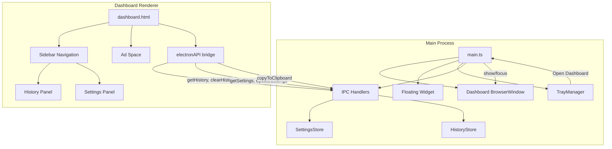
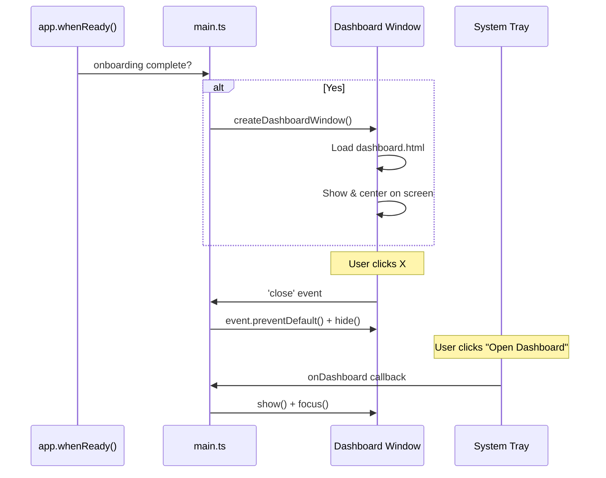

# Design Document: Main Dashboard Window

## Overview

The main dashboard window introduces a central hub for the Voice to Text Electron application. Currently, users interact only through a small floating widget and system tray — there is no "home base" window. The dashboard provides a single-page HTML interface with sidebar navigation, housing transcription history, settings management, and an ad space for monetization.

The design follows the same architectural pattern as the existing onboarding and settings windows: a single HTML file with inline CSS and vanilla JavaScript, communicating with the main process via the existing `electronAPI` preload bridge. No framework is introduced — this keeps the implementation consistent with the rest of the app.

### Key Design Decisions

1. **Single HTML file with JS tab switching** — Matches the onboarding.html pattern. No build step needed for the renderer.
2. **Dashboard replaces the separate settings window** — The `createSettingsWindow()` function and `settings.html` become obsolete. Settings live inside the dashboard's Settings panel.
3. **Hide-on-close behavior** — The dashboard hides to tray on close (like the widget), keeping the app running.
4. **New IPC channel for dashboard** — A `SHOW_DASHBOARD` channel allows the tray and other components to request the dashboard be shown.
5. **Reuse existing IPC channels** — History, settings, and clipboard operations already have IPC handlers. The dashboard renderer calls the same `electronAPI` methods.

## Architecture



### Window Lifecycle



## Components and Interfaces

### 1. Dashboard Window (Main Process)

**File:** `apps/electron/src/main/main.ts` (new function)

```typescript
function createDashboardWindow(): BrowserWindow {
  const win = new BrowserWindow({
    width: 1000,
    height: 700,
    minWidth: 900,
    minHeight: 600,
    center: true,
    frame: true,
    show: false,
    backgroundColor: '#0a0a0f',
    webPreferences: {
      preload: path.join(__dirname, '..', 'preload', 'preload.js'),
      contextIsolation: true,
      nodeIntegration: false,
      sandbox: false,
    },
  });

  win.loadFile(path.join(__dirname, '..', 'renderer', 'dashboard', 'dashboard.html'));

  win.on('close', (event) => {
    if (!isQuitting) {
      event.preventDefault();
      win.hide();
    }
  });

  win.once('ready-to-show', () => {
    win.show();
  });

  return win;
}
```

**Changes to existing code:**
- Add `dashboardWindow` variable alongside existing window references
- Remove `settingsWindow` variable and `createSettingsWindow()` function
- Update `OPEN_SETTINGS` IPC handler to show the dashboard with settings panel active (or add a new `SHOW_DASHBOARD` channel)
- Update `initTray()` to include "Open Dashboard" and trigger dashboard show

### 2. Updated TrayManager

**File:** `apps/electron/src/main/tray-manager.ts`

The tray context menu gains an "Open Dashboard" item at the top. The existing "Settings" item is removed (settings now live in the dashboard). Double-click on the tray icon shows the dashboard.

```typescript
interface TrayCallbacks {
  onDashboard: () => void;
  onHistory: () => void;
  onQuit: () => void;
}
```

Menu template:
```
Open Dashboard
─────────────
🎙 Start/Stop Recording
─────────────
Quit
```

The tray's `double-click` event triggers `onDashboard()`.

### 3. IPC Channel Addition

**File:** `apps/electron/src/shared/ipc-channels.ts`

```typescript
export enum IpcChannel {
  // ... existing channels ...
  SHOW_DASHBOARD = 'show-dashboard',
}
```

### 4. Preload API Addition

**File:** `apps/electron/src/preload/preload.ts`

```typescript
showDashboard(): Promise<void> {
  return ipcRenderer.invoke(IpcChannel.SHOW_DASHBOARD);
}
```

### 5. Dashboard HTML/CSS/JS (Renderer)

**File:** `apps/electron/src/renderer/dashboard/dashboard.html`

A single HTML file containing:
- **Sidebar** (200px fixed width): App logo/name, nav items (History, Settings)
- **Main content area** (flex: 1): Renders the active panel
- **Ad banner** (90px fixed height at bottom of content area)

Navigation is handled by showing/hiding `<section>` elements via JS class toggling — no page reloads.

#### Layout Structure

```
┌──────────────────────────────────────────────────┐
│ ┌─────────┐ ┌──────────────────────────────────┐ │
│ │ SIDEBAR │ │         CONTENT AREA             │ │
│ │         │ │                                  │ │
│ │ Logo    │ │  [History entries / Settings]     │ │
│ │         │ │                                  │ │
│ │ History │ │                                  │ │
│ │ Settings│ │                                  │ │
│ │         │ ├──────────────────────────────────┤ │
│ │         │ │         AD SPACE (90px)          │ │
│ └─────────┘ └──────────────────────────────────┘ │
└──────────────────────────────────────────────────┘
```

### 6. History Panel Component

Renders `TranscriptEntry[]` from `electronAPI.getHistory()`:
- Each entry shows: transcribed text (truncated with expand), relative timestamp, duration badge
- Copy button per entry
- "Clear History" button with confirmation dialog
- Empty state when no entries exist
- Listens for new transcriptions via a periodic poll or IPC event

### 7. Settings Panel Component

Migrates all functionality from the existing `settings.html`:
- Hotkey capture input (readonly, captures key combos on focus)
- Model selector dropdown
- Language selector dropdown
- Toggle switches: auto-copy, show widget, launch at startup
- Save button with success toast
- Loads current settings on panel activation

## Data Models

### Existing Models (No Changes)

```typescript
// From shared/types.ts - used as-is
interface TranscriptEntry {
  id: string;
  text: string;
  timestamp: number;    // Unix ms
  durationMs: number;
  modelName: string;
}

interface Settings {
  hotkeyAccelerator: string;
  hotkeyMode: 'toggle' | 'push-to-talk';
  modelName: string;
  language: string;
  autoCopyToClipboard: boolean;
  showFloatingWidget: boolean;
  launchAtStartup: boolean;
  silenceDurationMs: number;
  widgetPosition: { x: number; y: number } | null;
  onboardingComplete: boolean;
}
```

### Dashboard UI State (Renderer-only, in-memory)

```typescript
interface DashboardState {
  activePanel: 'history' | 'settings';
  historyEntries: TranscriptEntry[];
  settings: Settings;
  settingsSaveStatus: 'idle' | 'saving' | 'saved' | 'error';
}
```

This state is managed entirely in the dashboard's inline `<script>` — no external state library needed.

## Correctness Properties

*A property is a characteristic or behavior that should hold true across all valid executions of a system — essentially, a formal statement about what the system should do. Properties serve as the bridge between human-readable specifications and machine-verifiable correctness guarantees.*

### Property 1: History entries are displayed in reverse chronological order

*For any* set of `TranscriptEntry` objects returned by the history store, the rendered history list SHALL display them in descending order of `timestamp` (most recent first), such that for every adjacent pair of entries (entry_i, entry_i+1), `entry_i.timestamp >= entry_i+1.timestamp`.

**Validates: Requirements 3.1**

### Property 2: History entry rendering contains all required fields

*For any* valid `TranscriptEntry` with non-empty text, a positive timestamp, and a positive durationMs, the rendered HTML for that entry SHALL contain the transcribed text, a human-readable representation of the timestamp, and the recording duration.

**Validates: Requirements 3.2**

### Property 3: Settings persistence round-trip

*For any* valid `Settings` object (with a non-empty hotkeyAccelerator, a valid modelName from the allowed set, and boolean toggle values), saving the settings via `updateSettings()` and then retrieving them via `getSettings()` SHALL return values equivalent to what was saved.

**Validates: Requirements 4.5, 4.7**

## Error Handling

### Window Creation Failures

| Scenario | Handling |
|----------|----------|
| Dashboard HTML file not found | Electron logs error; app continues with widget-only mode |
| Preload script missing | BrowserWindow fails to expose electronAPI; dashboard shows static HTML without functionality |

### IPC Communication Errors

| Scenario | Handling |
|----------|----------|
| `getHistory()` fails | Display empty state with "Unable to load history" message |
| `getSettings()` fails | Display settings form with default values; log error to console |
| `updateSettings()` fails | Show error toast "Failed to save settings"; retain form values for retry |
| `copyToClipboard()` fails | Show brief error indicator on the copy button |
| `clearHistory()` fails | Show error message; do not clear the UI list |

### Edge Cases

| Scenario | Handling |
|----------|----------|
| History has 0 entries | Show empty state placeholder with message |
| History has 100 entries (max) | Render all; oldest entries are already pruned by HistoryStore |
| Transcription text is very long | Truncate display to ~200 chars with "Show more" expand |
| Settings hotkey field left empty | Prevent save; show validation hint |
| Window resized below 700×500 | Content scrolls; sidebar remains fixed; layout doesn't break |
| Dashboard opened before onboarding complete | Should not happen — dashboard creation is gated by `onboardingComplete` flag |

## Testing Strategy

### Unit Tests (Example-Based)

Unit tests cover specific behaviors, UI structure, and edge cases:

1. **Window configuration** — Verify `createDashboardWindow()` sets correct options (minWidth, minHeight, center, backgroundColor)
2. **Close-to-tray behavior** — Verify close event calls `preventDefault()` and `hide()` when `isQuitting` is false
3. **Navigation switching** — Click History nav → history panel visible, settings hidden; click Settings → vice versa
4. **Default panel** — On load, history panel is active
5. **Empty state** — When history is empty, empty state message is displayed
6. **Copy button** — Clicking copy calls `electronAPI.copyToClipboard(entry.text)`
7. **Clear history with confirmation** — Clear button shows confirm dialog; on confirm, calls `clearHistory()`
8. **Hotkey capture** — Keydown with Ctrl+Shift+A produces "Ctrl+Shift+A" in input
9. **Settings save feedback** — After successful save, confirmation message appears for ~2 seconds
10. **Tray menu structure** — "Open Dashboard" appears as first menu item
11. **Tray double-click** — Double-click event triggers dashboard show/focus
12. **Ad space placeholder** — Ad area renders with 90px min-height and placeholder content

### Property-Based Tests

Property-based tests verify universal correctness properties across generated inputs. Uses **fast-check** (already available in the JS/TS ecosystem, compatible with the project's test setup).

Configuration:
- Minimum 100 iterations per property test
- Each test tagged with feature and property reference

| Property | Test Description | Generator |
|----------|-----------------|-----------|
| Property 1: History ordering | Generate random arrays of TranscriptEntry with varying timestamps, verify rendered order is descending | `fc.array(fc.record({id: fc.uuid(), text: fc.string(), timestamp: fc.integer(), durationMs: fc.nat(), modelName: fc.string()}))` |
| Property 2: Entry rendering | Generate random TranscriptEntry objects, call render function, assert output contains text + formatted time + duration | `fc.record({id: fc.uuid(), text: fc.string({minLength:1}), timestamp: fc.integer({min:1}), durationMs: fc.nat({min:1}), modelName: fc.string()})` |
| Property 3: Settings round-trip | Generate random valid Settings objects, save then load, assert equality | `fc.record({hotkeyAccelerator: fc.string({minLength:1}), modelName: fc.constantFrom('tiny.en','base.en','small.en','medium.en'), ...})` |

Tag format: `// Feature: main-dashboard-window, Property {N}: {title}`

### Integration Tests

- Dashboard window creation and display after onboarding
- Tray "Open Dashboard" click shows and focuses the window
- New transcription appears in dashboard history without manual refresh
- Settings changes in dashboard apply to the main process (e.g., hotkey re-registration)

