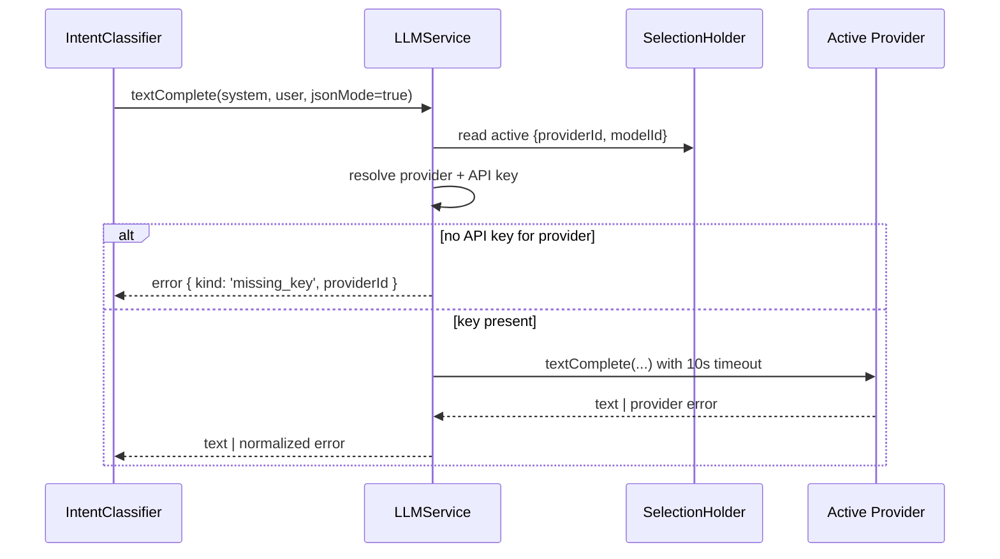
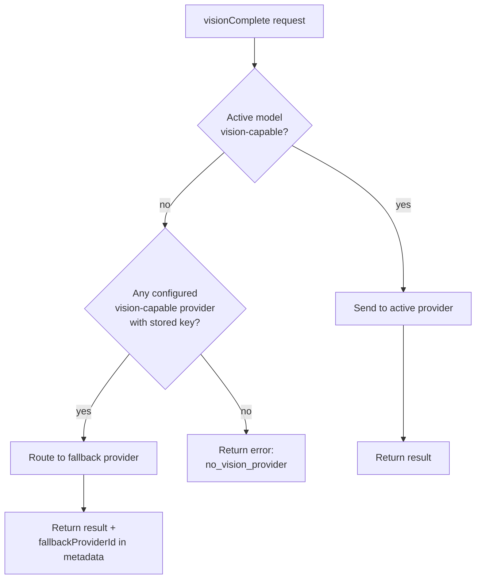
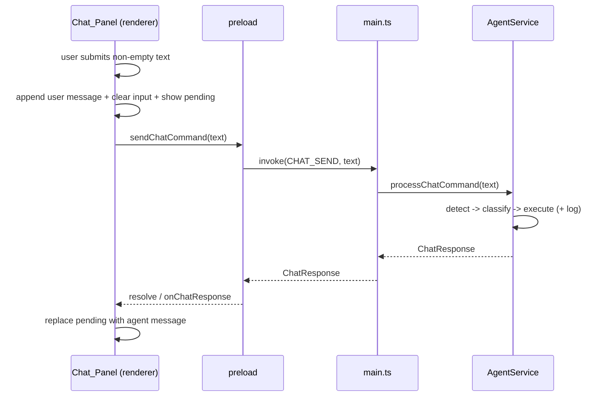

# Design Document

## Overview

This feature introduces a provider-agnostic LLM layer to the existing voice AI agent and adds a text chat panel to the dashboard. Today, two components talk to OpenAI directly: `IntentClassifier` (GPT-4o-mini, text classification) and `PageAnalyzer` (GPT-4o, vision). This design extracts all model access behind a single `LLMService` that routes requests to one of three providers — OpenAI, Google Gemini, and DeepSeek — selected at runtime.

The design has four pillars:

1. **Provider abstraction** — A small `LLMProvider` interface with two operations (`textComplete`, `visionComplete`). Three concrete implementations wrap the OpenAI SDK, the Google Generative AI SDK, and an OpenAI-compatible DeepSeek client.
2. **Runtime selection and instant switching** — A mutable `SelectionHolder` carries the active `{providerId, modelId}`. Settings updates write to this holder synchronously, so the next request picks up the change with no restart. In-flight requests are unaffected because each call snapshots its provider/model at the start.
3. **Capability-aware routing** — A static `ProviderRegistry` declares which models support vision. When the active model lacks vision (DeepSeek), `LLMService` transparently routes vision requests to any configured vision-capable provider and signals the fallback to the user.
4. **Text chat** — A new `Chat_Panel` in the dashboard sends typed text over a new IPC channel (`CHAT_SEND`) to `AgentService.processChatCommand`, which runs the existing pipeline and returns a structured `ChatResponse` (rather than the boolean-ish `AgentResult` used for voice). The panel renders a conversation history of user and agent messages.

### Research Notes

- **OpenAI SDK reuse for DeepSeek.** DeepSeek exposes an OpenAI-compatible Chat Completions API. The existing `openai` package (already a dependency, v6) accepts a `baseURL` option, so `DeepSeekProvider` constructs `new OpenAI({ apiKey, baseURL: 'https://api.deepseek.com' })` and calls `chat.completions.create` exactly as `OpenAIProvider` does. No new dependency is needed for DeepSeek. JSON output is requested via `response_format: { type: 'json_object' }`; because compatibility can vary, the system prompt also explicitly instructs the model to reply with JSON only.
- **Gemini SDK.** Google's `@google/generative-ai` package is the official client. Text and vision both go through `getGenerativeModel({ model }).generateContent(...)`. JSON mode is configured via `generationConfig: { responseMimeType: 'application/json' }`. Images are passed as `inlineData` parts with `{ mimeType, data }` where `data` is base64 (no `data:` URL prefix). This is a new dependency to add to `apps/electron/package.json`.
- **Message-shape differences.** OpenAI uses a `messages` array with `system`/`user` roles and content parts (`text`, `image_url`). Gemini uses `systemInstruction` plus a `contents` array of parts. Each provider implementation is responsible for translating the uniform `(systemPrompt, userMessage, image?)` inputs into its own SDK shape, so callers never see these differences.
- **Existing obfuscation pattern.** `AgentService` already stores the OpenAI key base64-obfuscated in memory and persists the plaintext in `electron-store`. The requirement to store keys "obfuscated rather than plain text in the settings file" means persisting base64-encoded key values in the store. This design keeps the existing in-memory obfuscation and adds base64-at-rest for all three keys via the settings layer.

## Architecture

### Module layout

New files (all under `apps/electron/src/main/agent/llm/`):

- `provider-registry.ts` — static metadata (providers → models → vision capability + display names).
- `llm-service.ts` — `LLMService`, `SelectionHolder`, routing, fallback, error normalization.
- `providers/llm-provider.ts` — `LLMProvider` interface + shared request/response types.
- `providers/openai-provider.ts` — `OpenAIProvider`.
- `providers/gemini-provider.ts` — `GeminiProvider`.
- `providers/deepseek-provider.ts` — `DeepSeekProvider`.

Modified files:

- `intent-classifier.ts` — depends on `LLMService` instead of `OpenAI`.
- `page-analyzer.ts` — depends on `LLMService` for vision/text instead of `OpenAI`.
- `react-loop.ts` / `browser-agent.ts` — pass an `LLMService` instead of a raw `apiKey`.
- `agent-service.ts` — owns the `LLMService`; adds `processChatCommand`.
- `shared/types.ts` — new settings fields, provider/chat types.
- `shared/ipc-channels.ts` — `CHAT_SEND`, `CHAT_RESPONSE`.
- `preload/preload.ts` — `sendChatCommand`, `onChatResponse`.
- `main.ts` — wire `CHAT_SEND` handler, apply provider/model/key settings to `LLMService`, run legacy migration.
- `settings-store.ts` — defaults for new fields, base64 obfuscation for keys, legacy migration.
- `renderer/dashboard/dashboard.html` — Chat panel UI + settings fields (provider/model dropdowns, per-provider keys).

### Request flow (text)



### Vision routing flow



`PageAnalyzer`/`AgentService` inspect the returned metadata: when `fallbackProviderId` is present, `AgentService` shows a toast naming the fallback provider; when the error is `no_vision_provider`, `AgentService` shows an error toast and the browser task ends as `failed`.

### Chat flow



`CHAT_SEND` is implemented with `ipcMain.handle` (request/response), so the response returns directly from the `invoke` promise. `CHAT_RESPONSE` is reserved as a push channel for any out-of-band agent message (kept for symmetry and future streaming); the MVP resolves via the `invoke` return value.

## Components and Interfaces

### LLMProvider interface

```typescript
// providers/llm-provider.ts
export type ProviderId = 'openai' | 'gemini' | 'deepseek';

export interface TextCompleteParams {
  systemPrompt: string;
  userMessage: string;
  jsonMode: boolean;
  modelId: string;
  apiKey: string;
  timeoutMs?: number;
}

export interface VisionCompleteParams {
  systemPrompt: string;
  userMessage: string;
  imageBase64: string; // raw base64, no data: prefix
  modelId: string;
  apiKey: string;
  timeoutMs?: number;
}

export type LLMErrorKind =
  | 'timeout'
  | 'network'
  | 'invalid_key'
  | 'http_error'
  | 'missing_key'
  | 'no_vision_provider'
  | 'unsupported'
  | 'empty_response';

export interface LLMError {
  kind: LLMErrorKind;
  providerId: ProviderId;
  message: string;
  httpStatus?: number;
}

export type LLMResult =
  | { ok: true; text: string }
  | { ok: false; error: LLMError };

export interface LLMProvider {
  readonly id: ProviderId;
  textComplete(params: TextCompleteParams): Promise<LLMResult>;
  visionComplete(params: VisionCompleteParams): Promise<LLMResult>;
}
```

Notes:
- Each provider receives `modelId` and `apiKey` per call. Providers are stateless; `LLMService` owns selection and keys. This keeps providers trivially testable and makes instant switching a no-op at the provider layer.
- `DeepSeekProvider.visionComplete` returns `{ ok: false, error: { kind: 'unsupported', providerId: 'deepseek', ... } }`. In practice `LLMService` never calls it because the registry marks DeepSeek non-vision and routes around it, but the guard keeps the contract total.

### ProviderRegistry

```typescript
// provider-registry.ts
export interface ModelInfo {
  id: string;          // Model_Id, e.g. 'gpt-4o-mini'
  displayName: string; // e.g. 'GPT-4o mini'
  vision: boolean;     // Vision_Capability
}

export interface ProviderInfo {
  id: ProviderId;
  displayName: string; // 'OpenAI' | 'Google Gemini' | 'DeepSeek'
  models: ModelInfo[];
}

export const PROVIDER_REGISTRY: ProviderInfo[] = [
  {
    id: 'openai',
    displayName: 'OpenAI',
    models: [
      { id: 'gpt-4o-mini', displayName: 'GPT-4o mini', vision: true },
      { id: 'gpt-4o', displayName: 'GPT-4o', vision: true },
    ],
  },
  {
    id: 'gemini',
    displayName: 'Google Gemini',
    models: [
      { id: 'gemini-1.5-flash', displayName: 'Gemini 1.5 Flash', vision: true },
      { id: 'gemini-1.5-pro', displayName: 'Gemini 1.5 Pro', vision: true },
      { id: 'gemini-2.0-flash', displayName: 'Gemini 2.0 Flash', vision: true },
    ],
  },
  {
    id: 'deepseek',
    displayName: 'DeepSeek',
    models: [
      { id: 'deepseek-chat', displayName: 'DeepSeek Chat', vision: false },
    ],
  },
];

// Helper functions (pure, used by LLMService and the settings UI):
export function getProvider(id: ProviderId): ProviderInfo | undefined;
export function getModel(providerId: ProviderId, modelId: string): ModelInfo | undefined;
export function isVisionCapable(providerId: ProviderId, modelId: string): boolean;
export function firstModelOf(providerId: ProviderId): string;       // first listed model id
export function visionCapableProviders(): ProviderId[];             // providers with >=1 vision model
export const DEFAULT_SELECTION = { providerId: 'openai', modelId: 'gpt-4o-mini' } as const;
```

### SelectionHolder and key store

```typescript
// llm-service.ts
export interface ActiveSelection {
  providerId: ProviderId;
  modelId: string;
}

class SelectionHolder {
  private selection: ActiveSelection = { ...DEFAULT_SELECTION };
  get(): ActiveSelection { return this.selection; }
  set(next: ActiveSelection): void { this.selection = next; }
}
```

API keys are held in an in-memory map `Record<ProviderId, string>` inside `LLMService`, updated whenever settings change. `LLMService` reads the holder + key map at the start of each request, so:
- A `setActiveSelection` call changes the next request immediately (Req 6.1, 6.2).
- A request already running keeps the selection it snapshotted (Req 6.3).
- A `setApiKey(providerId, key)` call applies to that provider's next request (Req 7.3).

### LLMService

```typescript
// llm-service.ts
export class LLMService {
  constructor(providers?: Partial<Record<ProviderId, LLMProvider>>); // defaults to real providers

  // Selection (instant switching)
  setActiveSelection(providerId: ProviderId, modelId: string): void; // validates against registry
  getActiveSelection(): ActiveSelection;

  // Keys
  setApiKey(providerId: ProviderId, key: string): void;
  hasApiKey(providerId: ProviderId): boolean;

  // Core operations (Req 1.1, 1.2)
  textComplete(systemPrompt: string, userMessage: string, jsonMode: boolean): Promise<LLMResult>;
  visionComplete(systemPrompt: string, userMessage: string, imageBase64: string): Promise<VisionResult>;
}

// Vision result carries fallback metadata so the caller can notify the user (Req 9.3)
export type VisionResult =
  | { ok: true; text: string; fallbackProviderId?: ProviderId }
  | { ok: false; error: LLMError };
```

Behavioral contract:
- `textComplete` snapshots `{providerId, modelId}` and the key. If no key → `missing_key` error (Req 6.5). Otherwise delegates to the provider with a 10s timeout (Req 13.1).
- `visionComplete` checks `isVisionCapable(active)`. If capable → active provider (Req 9.1). If not → pick the first vision-capable provider (registry order) that `hasApiKey` (Req 9.2), call it, and tag the result with `fallbackProviderId` (Req 9.3). If none has a key → `no_vision_provider` error (Req 9.4).
- All provider errors are returned as `LLMError` values (never thrown) so callers branch on `ok`. Authentication failures map to `invalid_key` (Req 8.4); HTTP errors carry `httpStatus` (Req 13.2); connection failures map to `network` (Req 13.3).

### IntentClassifier (refactored)

- Constructor takes an `LLMService` instead of an API key string. Removes the `openai` import and `setApiKey`.
- `classify(commandText)` calls `llm.textComplete(SYSTEM_PROMPT, commandText, true)`. On `ok: false`, it maps the `LLMError.kind` to the existing `ClassificationError.type` (`timeout`/`network`/`invalid_key`/`api_error`/`parse_error`) so `AgentService` logic is unchanged.
- `parseResponse` is unchanged: it still parses JSON, validates `action`/`target`/`confidence`, ignores unknown fields (Req 14.1, 14.2, 14.3, 14.5).

### PageAnalyzer (refactored)

- Constructor takes an `LLMService` instead of an API key string. Removes the `openai` import.
- `generatePlan(command)` → `llm.textComplete(plannerPrompt, userPrompt, false)`.
- `analyzeScreenshot(screenshot, ctx, steps)` → `llm.visionComplete(SYSTEM_PROMPT, userMessage, screenshot.toString('base64'))`. The `data:image/png;base64,` prefix construction moves into `OpenAIProvider` (which needs the data URL); the analyzer passes raw base64.
- `parseVisionResponse` is unchanged. If `visionComplete` returns `fallbackProviderId`, `PageAnalyzer` surfaces it up so `AgentService` can toast (Req 9.3). If the result is the `no_vision_provider` error, analysis throws a typed error that `BrowserAgent` reports as a failed task (Req 9.4).

### ReactLoop / BrowserAgent wiring

- `ReactLoopConfig` replaces `apiKey: string` with `llm: LLMService`.
- `BrowserAgentConfig` replaces `apiKey` with a reference to the shared `LLMService` (or the service is injected into `ReactLoop` directly). `ActionExecutor.setBrowserConfig` stops passing an API key and instead ensures the `LLMService` is available. Because the `LLMService` instance is shared and mutable, browser tasks automatically use the current selection/keys.

### AgentService (extended)

```typescript
async processChatCommand(text: string): Promise<ChatResponse>;
```

`processChatCommand` mirrors `process` but returns a `ChatResponse` instead of `AgentResult`:
1. If agent mode disabled → `ChatResponse { kind: 'agent', status: 'disabled', text: 'Enable AI agent mode in Settings to process typed commands.' }` (Req 11.6).
2. If the active provider has no stored key → status `'error'` text prompting for the key (Req 7.5 analog for chat; Req 13.5).
3. `CommandDetector.detect` → if not a command, status `'not_command'` (Req 11.2).
4. `IntentClassifier.classify` → on failure, status `'error'` with the error description (Req 13.5). On confidence < 0.7, status `'low_confidence'` (Req 11.3).
5. `ActionExecutor.execute` → status `'success'`/`'error'` plus a human-readable description of the action (Req 11.4). Records an `ActionLogEntry` identical in shape to voice commands (Req 11.5).

The constructor wires `IntentClassifier(llmService)` and exposes `llmService` setters used by `main.ts`: `setActiveSelection`, `setProviderApiKey`. The voice `process` path is updated so that any LLM failure falls back to dictation (Req 13.4) — same as today, just sourced from `LLMError`.

### Settings layer

`SettingsStore` gains:
- Defaults: `geminiApiKey: ''`, `deepseekApiKey: ''`, `llmProvider: ''`, `llmModel: ''` (empty selection means "use in-memory default", Req 2.4).
- Obfuscation: `openaiApiKey`, `geminiApiKey`, `deepseekApiKey` are stored base64-encoded; `getAll`/`get` decode them so the rest of the app sees plaintext (Req 7.2).
- Legacy migration: on construction, if a legacy plaintext `openaiApiKey` exists and has not yet been obfuscated/migrated, encode it in place and set a `legacyKeyMigrated` flag; perform once (Req 7.4).

`main.ts` `UPDATE_SETTINGS` handler additions:
- `llmProvider` / `llmModel` → `agentService.setActiveSelection(provider, model)` (instant, Req 6.1) and persist (Req 6.4).
- `openaiApiKey` / `geminiApiKey` / `deepseekApiKey` → `llmService.setApiKey(providerId, key)` (Req 7.3).

### Chat_Panel (renderer)

- New sidebar nav item "Chat" and `#panel-chat` section containing: scrollable `#chat-history`, a text input `#chat-input`, and a `#chat-send` button.
- `sendChat()`:
  - Trims input; if empty, no-op (Req 10.5).
  - Appends a user `Chat_Message`, clears input immediately (Req 10.6, 12.1), appends a pending indicator (Req 12.5), and scrolls to bottom (Req 12.4).
  - Calls `window.electronAPI.sendChatCommand(text)`; on resolution, replaces the pending indicator with an agent `Chat_Message` (Req 12.2) and scrolls.
- Enter key on the focused input with non-empty value triggers `sendChat()` (Req 10.4); Shift+Enter inserts a newline.
- Messages render in chronological order, newest at the bottom (Req 12.3).

## Data Models

### Settings additions (`shared/types.ts`)

```typescript
export interface Settings {
  // ...existing fields...
  openaiApiKey: string;     // existing
  geminiApiKey: string;     // new
  deepseekApiKey: string;   // new
  llmProvider: string;      // new — '' until user selects; '' => default 'openai'
  llmModel: string;         // new — '' until user selects; '' => default 'gpt-4o-mini'
}
```

### Provider/selection types (`providers/llm-provider.ts`, `llm-service.ts`)

`ProviderId`, `ModelInfo`, `ProviderInfo`, `ActiveSelection`, `LLMError`, `LLMResult`, `VisionResult` as defined above.

### Chat types (`shared/types.ts`)

```typescript
export type ChatRole = 'user' | 'agent';

export type ChatResponseStatus =
  | 'success'        // action executed successfully
  | 'error'          // execution or LLM error
  | 'not_command'    // detector classified as dictation
  | 'low_confidence' // confidence < 0.7
  | 'disabled';      // agent mode off

export interface ChatResponse {
  status: ChatResponseStatus;
  text: string;                 // human-readable agent reply for the history
  intentType?: ActionType;      // present when classification succeeded
  target?: string;              // present when classification succeeded
  actionLogId?: string;         // id of the recorded ActionLogEntry, when one was created
}

// Renderer-only view model (not persisted in main):
export interface ChatMessage {
  id: string;
  role: ChatRole;
  text: string;
  timestamp: number;
  pending?: boolean;            // true while awaiting the agent response
}
```

### IPC channels (`shared/ipc-channels.ts`)

```typescript
CHAT_SEND = 'chat-send',         // renderer -> main (invoke); returns ChatResponse
CHAT_RESPONSE = 'chat-response', // main -> renderer (reserved push channel)
```

### ClassifiedIntent (unchanged, referenced by round-trip property)

```typescript
export interface ClassifiedIntent {
  action: ActionType;
  target: string;
  confidence: number;
  parameters?: Record<string, unknown>;
}
```

## Correctness Properties

*A property is a characteristic or behavior that should hold true across all valid executions of a system — essentially, a formal statement about what the system should do. Properties serve as the bridge between human-readable specifications and machine-verifiable correctness guarantees.*

These properties cover the pure, input-varying logic of the feature: request routing, instant switching, vision fallback, error normalization, key obfuscation/migration, validation, registry-driven UI population, intent parsing, and chat-response mapping. Provider-internal SDK wiring, static registry contents, persistence side effects, and UI rendering are validated by example/integration tests in the Testing Strategy instead.

### Property 1: Text requests route to the active selection with its provider's key

*For any* Active_Selection (a provider and one of its registry models) and any non-empty API key configured for that provider, a text-completion request SHALL be delivered to the provider identified by the Active_Selection, using that provider's stored API key and the selected model.

**Validates: Requirements 1.3, 2.2, 3.2, 4.2, 6.1, 6.2, 7.3**

### Property 2: In-progress requests use the selection current when they started

*For any* text- or vision-completion request that has started, changing the Active_Selection before that request resolves SHALL NOT change which provider and model serve it; the request completes using the selection that was current when it started.

**Validates: Requirements 6.3**

### Property 3: Requests fail with a missing-key error when the active provider has no key

*For any* Active_Selection whose provider has no stored API key, a completion request SHALL fail and return an error of kind `missing_key` identifying that provider.

**Validates: Requirements 6.5**

### Property 4: Vision requests route by capability with fallback and error branches

*For any* Active_Selection and any configuration of per-provider API keys, a vision-completion request SHALL behave as follows: if the active model is vision-capable, it routes to the active provider with no fallback flag; if the active model is not vision-capable and at least one vision-capable provider has a stored key, it routes to such a vision-capable provider and the successful result carries that provider's id as the fallback provider; if the active model is not vision-capable and no vision-capable provider has a stored key, it returns a `no_vision_provider` error.

**Validates: Requirements 9.1, 9.2, 9.3, 9.4**

### Property 5: Provider errors are normalized with provider identity preserved

*For any* provider and any provider failure (authentication failure, HTTP error with a status code, network failure, or a request exceeding the 10-second text timeout), the LLM_Service SHALL return an `LLMError` whose `kind` matches the failure category (`invalid_key`, `http_error`, `network`, `timeout`) and whose `providerId` identifies the affected provider, carrying the HTTP status code when the failure is an HTTP error.

**Validates: Requirements 8.4, 13.1, 13.2, 13.3**

### Property 6: API key obfuscation round-trips and never stores plaintext

*For any* API key string, decoding the obfuscated value produced by the Settings_Store SHALL reproduce the original key exactly, and for any non-empty key the stored obfuscated value SHALL differ from the plaintext key.

**Validates: Requirements 7.2**

### Property 7: Legacy key migration is idempotent and conditional

*For any* initial settings state, applying the legacy-key migration twice SHALL produce the same result as applying it once, and the migration SHALL change the settings state only when a legacy OpenAI key value is present.

**Validates: Requirements 7.4**

### Property 8: Per-provider API key validation matches the format rules

*For any* candidate key string, the validation result SHALL equal: for OpenAI and DeepSeek, the string begins with "sk-" and has length at least 20; for Gemini, the string has length at least 20.

**Validates: Requirements 8.1, 8.2, 8.3**

### Property 9: Model options follow the registry for the selected provider

*For any* provider in the Provider_Registry, the model dropdown options computed for that provider SHALL equal exactly that provider's registry models, and selecting that provider SHALL set the chosen model to the provider's first listed model, which is always a member of that provider's models.

**Validates: Requirements 5.2, 5.3**

### Property 10: Intent serialization round-trip preserves the intent

*For any* valid intent object (action type, target, confidence, and optional parameters), serializing it to JSON and parsing the result again SHALL produce an equivalent intent object.

**Validates: Requirements 14.4**

### Property 11: Intent parsing is robust to malformed and extra-field input

*For any* provider text response: when the response is not valid JSON, parsing SHALL return a parse error; when the response is a JSON object missing the action, target, or confidence field, parsing SHALL return a parse error identifying the missing field(s); and when the response is a valid intent object augmented with arbitrary additional fields, parsing SHALL ignore the extra fields and produce the same intent as the response without them.

**Validates: Requirements 14.1, 14.2, 14.3, 14.5**

### Property 12: Chat responses map pipeline outcomes to the correct status

*For any* typed command, the chat response status SHALL reflect the pipeline outcome: `disabled` when agent mode is off; `not_command` when the Command_Detector classifies the input as dictation; `low_confidence` when classification confidence is below 0.7; `error` when the LLM_Service request fails (with the error description included in the response text); and `success` or `error` matching the Action_Executor result otherwise, with the response text describing the action taken.

**Validates: Requirements 11.2, 11.3, 11.4, 11.6, 13.5**

### Property 13: Processing a typed command records a well-formed action log entry

*For any* typed command that is classified as a command with sufficient confidence and executed, the Agent_Service SHALL record an Action_Log entry with the same structure as voice commands (id, timestamp, command text, intent type, target, status, and duration).

**Validates: Requirements 11.5**

## Error Handling

All LLM access funnels through `LLMService`, which converts every failure mode into an `LLMError` value rather than throwing. Callers branch on the `ok` discriminant.

| Failure | Detection | `LLMError.kind` | Caller behavior |
| --- | --- | --- | --- |
| Missing API key for active/target provider | `hasApiKey` check before dispatch | `missing_key` | Voice: notify + dictation fallback. Chat: `error` response naming provider (Req 6.5, 7.5). |
| Text request exceeds 10s | `AbortController` + timer | `timeout` | Voice: dictation fallback. Chat: `error` response (Req 13.1). |
| Provider HTTP error | SDK error with status | `http_error` (+ `httpStatus`) | Surface provider + status (Req 13.2). |
| Network unreachable | connection error string match (`econnrefused`, `enotfound`, `fetch failed`, etc.) | `network` | Surface provider (Req 13.3). |
| Auth rejected (401) | SDK 401 | `invalid_key` | Surface provider; voice path may disable agent as today (Req 8.4). |
| Active model lacks vision, no keyed vision provider | registry + key check | `no_vision_provider` | `AgentService` error toast; browser task ends `failed` (Req 9.4). |
| Empty/blank model output | post-response check | `empty_response` | Treated as failure on both paths. |
| Malformed JSON / missing fields | `IntentClassifier.parseResponse` | n/a (returns `ClassificationError` `parse_error`) | Voice: dictation fallback. Chat: `error` response (Req 14.2, 14.3). |

Voice-path principle (Req 13.4): any LLM failure on a voice-originated request results in `handled: false`, so the original transcription flows to clipboard/history as plain dictation and is never lost. Chat-path principle (Req 13.5): failures produce an `error` `ChatResponse` whose text includes the description, so the user sees what went wrong in the conversation history.

Vision fallback notifications (Req 9.3) are non-error: a successful fallback returns `{ ok: true, fallbackProviderId }`, and `AgentService` shows an informational toast naming the fallback provider while the browser task proceeds.

## Testing Strategy

This feature mixes pure logic (well suited to property-based testing) with UI rendering, IPC wiring, static configuration, and external SDK calls (better served by example, integration, and smoke tests). The strategy below applies each technique where it fits.

### Property-based tests

Property-based testing applies to the routing, fallback, error-normalization, obfuscation, validation, registry-population, parsing, and chat-mapping logic — all pure or mock-isolated functions whose behavior varies meaningfully with input.

- **Library:** `fast-check` with the existing test runner (Jest/Vitest as configured for the workspace). Property-based testing MUST NOT be implemented from scratch.
- **Iterations:** each property test runs a minimum of 100 generated cases.
- **Provider isolation:** properties about `LLMService` use stub `LLMProvider` implementations that record the `modelId`/`apiKey` they receive and return scripted results or errors. No real network calls are made. Timeouts are exercised with fake timers.
- **Tagging:** each property test is tagged with a comment referencing its design property, in the format:
  `// Feature: multi-model-chat, Property {number}: {property_text}`
- **Coverage mapping:** Properties 1–13 above map one-to-one to a single property-based test each.
  - Generators: random `ActiveSelection` drawn from `PROVIDER_REGISTRY`; random per-provider key maps (including empty); arbitrary strings for key validation and parser robustness; arbitrary valid `ClassifiedIntent` objects (valid `ActionType`, arbitrary target string, confidence in [0,1], optional JSON-serializable parameters) for the round-trip; random HTTP status codes for error normalization.

### Unit (example) tests

- Registry contents and capability flags: providers/models listed exactly as specified, vision flags correct (Req 2.1, 2.3, 3.1, 3.3, 4.1, 4.3).
- Provider-internal SDK wiring with mocked SDKs: `OpenAIProvider` uses the OpenAI key/model (Req 2.2); `GeminiProvider` sets `responseMimeType: application/json` for JSON mode and passes `inlineData` images (Req 3.2, 3.4); `DeepSeekProvider` uses `baseURL: https://api.deepseek.com`, the DeepSeek key, and `response_format: json_object` (Req 4.2, 4.4).
- `IntentClassifier` and `PageAnalyzer` call the injected `LLMService` rather than a vendor SDK (Req 1.4, 1.5).
- Default selection on fresh state: in-memory default `openai`/`gpt-4o-mini`, persisted store empty (Req 2.4).
- Selection/preselection persistence (Req 5.4, 5.5, 6.4).
- Voice-path no-key behavior: notify + `handled: false` (Req 7.5); voice LLM-failure dictation fallback (Req 13.4).
- Pipeline ordering: detector → classifier → executor invocation order (Req 11.1).

### Edge-case tests

- Empty and whitespace-only chat input produces no send (Req 10.5).
- Default-selection boundary when persisted selection fields are empty strings (Req 2.4).

### UI / DOM tests

- Chat panel presence and structure: nav item, input, send control, scrollable history (Req 10.1, 10.2).
- Send via click and via Enter (non-empty) invoke `sendChatCommand` with the text; Shift+Enter does not send (Req 10.3, 10.4).
- Input clears immediately on send regardless of delivery (Req 10.6).
- History mutations: user message appended on send, agent message appended on response, chronological order newest-at-bottom, autoscroll, pending indicator lifecycle (Req 12.1, 12.2, 12.3, 12.4, 12.5).
- Settings panel: provider dropdown shows the three display names, per-provider key fields present, format warnings on blur (Req 5.1, 7.1, 8.1–8.3 UI surface).

### Integration tests

- End-to-end chat round trip across the `CHAT_SEND` IPC boundary: renderer → preload → main → `AgentService.processChatCommand` → `ChatResponse`, with `AgentService` backed by a stub `LLMService`.
- Browser-task vision fallback: with a non-vision active selection and a keyed vision provider, a browser task completes and an informational fallback toast is emitted (Req 9.3); with no keyed vision provider, the task ends `failed` with an error toast (Req 9.4).

### Smoke tests

- `LLMService` construction exposes both `textComplete` and `visionComplete` before use (Req 1.7).
- Adding a new provider to the registry routes through `LLMService` without modifying `IntentClassifier`/`PageAnalyzer` source (Req 1.6) — a construction-time test injecting a fake provider.
