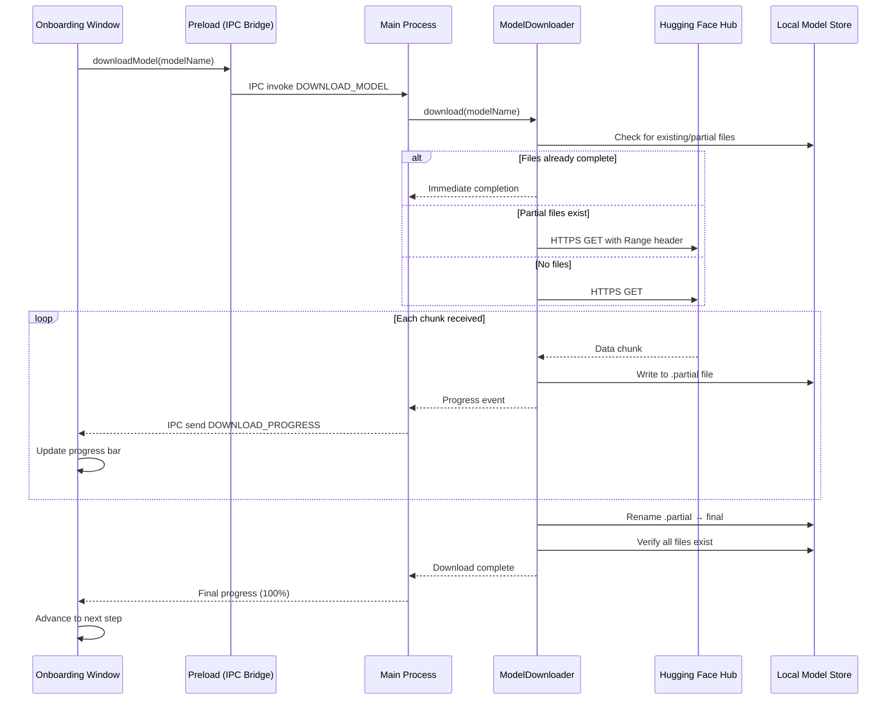
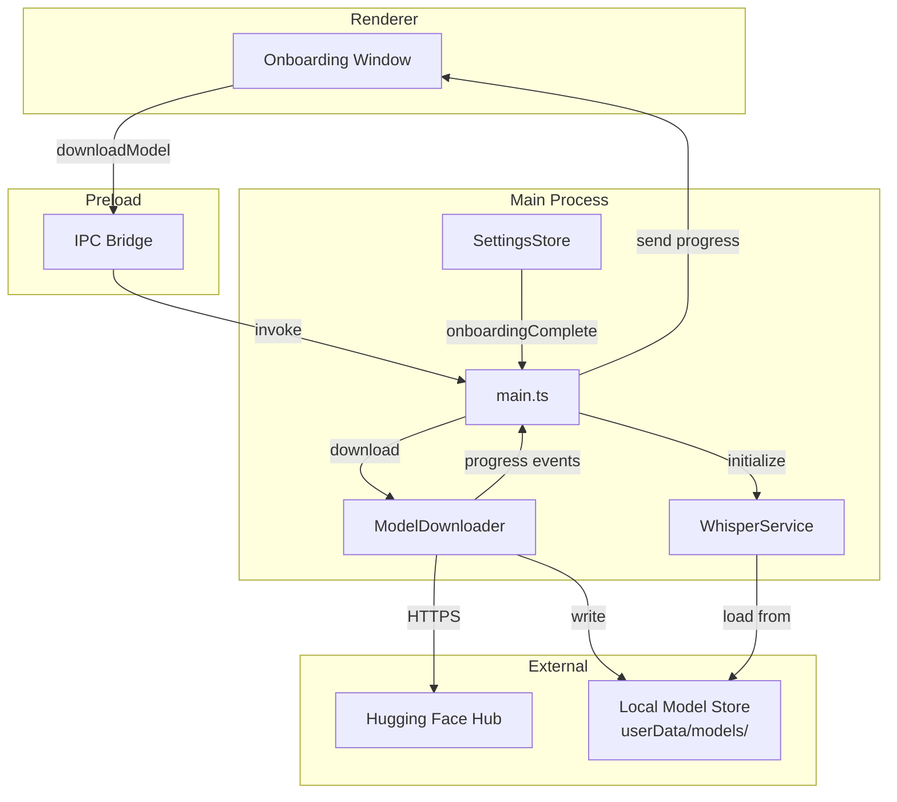

# Design Document: Runtime Model Download

## Overview

This design moves Whisper ONNX model acquisition from build-time bundling to runtime downloading during onboarding. The current installer bundles models inside `node_modules/@xenova/transformers` cache, inflating the package to ~331 MB. After this change, the installer ships without model weights, and the onboarding flow downloads them to the user's `userData` directory on first launch.

The key changes span four areas:
1. A new `ModelDownloader` main-process module that fetches model files from Hugging Face with resume support and progress reporting
2. Enhanced onboarding UI with a real-time progress bar, speed display, error handling, and retry
3. `WhisperService` updated to load models from `userData` instead of the bundled app path
4. `electron-builder` config updated to exclude `.onnx` weights and HF cache from the installer

## Architecture



### Component Interaction



### Design Decisions

1. **Dedicated ModelDownloader vs. reusing @xenova/transformers download**: The existing `WhisperService.initialize()` delegates downloading to `@xenova/transformers`' internal pipeline, which provides limited progress granularity and no resume support. A dedicated `ModelDownloader` gives us byte-level progress, HTTP Range resume, disk-space checks, and explicit error events. The `@xenova/transformers` cache directory is then pointed at the `Local_Model_Store` so the library finds pre-downloaded files.

2. **Partial file with `.partial` suffix**: Matches the existing `ModelManager` pattern. Files are written as `<name>.partial` and renamed atomically on completion, preventing the whisper service from loading incomplete files.

3. **Single IPC channel pair for download**: Reuses the existing `DOWNLOAD_MODEL` (invoke) and `DOWNLOAD_PROGRESS` (send) channels already defined in `ipc-channels.ts`, avoiding new channel proliferation.

4. **userData path for model storage**: Electron's `app.getPath('userData')` is per-user, survives app updates, and has write permissions by default. A `models/onnx/` subdirectory keeps ONNX artifacts separate from the existing ggml-based `ModelManager` models directory.

## Components and Interfaces

### 1. ModelDownloader (new module: `apps/electron/src/main/model-downloader.ts`)

Responsible for downloading Whisper ONNX model files from Hugging Face Hub to the local model store.

```typescript
interface ModelDownloadOptions {
  modelId: string;           // e.g. "Xenova/whisper-small.en"
  destDir: string;           // Local_Model_Store path
  onProgress?: (progress: DownloadProgress) => void;
  onError?: (error: DownloadError) => void;
  signal?: AbortSignal;      // For cancellation
}

interface DownloadError {
  message: string;
  code: 'NETWORK_ERROR' | 'DISK_PERMISSION' | 'DISK_SPACE' | 'VERIFICATION_FAILED';
  retryable: boolean;
}

interface ModelFile {
  name: string;              // e.g. "encoder_model_quantized.onnx"
  url: string;               // Full HF download URL
  expectedSize?: number;     // Bytes, if known from HF API
}

class ModelDownloader {
  constructor(destDir: string);

  /** Check if all required model files exist and are complete */
  isModelReady(modelId: string): boolean;

  /** Download all files for a model, resuming partial downloads */
  async download(options: ModelDownloadOptions): Promise<void>;

  /** Get list of files needed for a model variant */
  getRequiredFiles(modelId: string): ModelFile[];

  /** Check available disk space vs required space */
  async checkDiskSpace(requiredBytes: number): Promise<boolean>;
}
```

Key behaviors:
- Fetches the file manifest for a Whisper ONNX model (encoder, decoder, tokenizer, config JSON files)
- Downloads each file sequentially with HTTPS, writing to `<filename>.partial`
- Supports HTTP Range headers for resume when partial files exist
- Falls back to full re-download if server returns 200 instead of 206
- Emits `DownloadProgress` events per chunk with aggregated totals across all files
- Checks disk space before starting (using `fs.statfs` or platform check)
- Renames `.partial` → final on per-file completion
- Verifies all expected files exist before reporting overall completion

### 2. Updated WhisperService (`apps/electron/src/main/whisper-service.ts`)

Changes:
- Accept a `cacheDir` parameter pointing to the Local_Model_Store
- Set `env.cacheDir` on `@xenova/transformers` so it finds pre-downloaded files
- Set `env.allowLocalModels = true` and `env.allowRemoteModels = false` to prevent any network calls
- Return a descriptive error if model files are missing instead of attempting download

```typescript
class WhisperService {
  async initialize(options?: {
    cacheDir?: string;
    onProgress?: (data: ProgressData) => void;
  }): Promise<void>;

  isModelReady(cacheDir: string): boolean;
}
```

### 3. Updated Onboarding UI (`apps/electron/src/renderer/onboarding/onboarding.html`)

Changes to Step 3 (Download Model):
- Display a progress bar reflecting overall download percentage
- Show current file name being downloaded
- Show download speed in human-readable units (KB/s, MB/s)
- Show bytes downloaded / total bytes
- Display error message with retry button on failure
- Auto-advance to Step 4 on completion
- Prevent user from skipping to Step 4 while download is incomplete

### 4. Updated IPC Handler (`apps/electron/src/main/main.ts`)

The `DOWNLOAD_MODEL` handler changes from calling `whisperService.initialize()` to:
1. Instantiate `ModelDownloader` with the `userData/models/onnx` path
2. Check if model is already downloaded → skip
3. Check disk space → emit error if insufficient
4. Call `modelDownloader.download()` with progress forwarding to the onboarding window
5. On completion, initialize `WhisperService` with the cache dir

### 5. Updated Preload (`apps/electron/src/preload/preload.ts`)

No structural changes needed. The existing `downloadModel()` and `onDownloadProgress()` APIs already match the required IPC pattern. Minor addition:
- Add `retryDownload()` method that re-invokes `DOWNLOAD_MODEL`

### 6. Updated Build Config (`apps/electron/package.json`)

Add exclusion patterns to the `build.files` array:

```json
{
  "build": {
    "files": [
      "build/**/*",
      "assets/**/*",
      "node_modules/**/*",
      "!node_modules/@xenova/transformers/.cache/**/*",
      "!node_modules/**/*.onnx",
      "!node_modules/**/onnx/**/*.onnx"
    ]
  }
}
```

This excludes:
- Any pre-cached HF models in the transformers cache directory
- All `.onnx` weight files from any nested node_modules path

The `@xenova/transformers` JavaScript library code and `onnxruntime-node` native bindings remain included.

## Data Models

### DownloadProgress (existing type, extended)

```typescript
// apps/electron/src/shared/types.ts
interface DownloadProgress {
  modelName: string;        // e.g. "Xenova/whisper-small.en"
  bytesDownloaded: number;  // Total bytes downloaded across all files
  totalBytes: number;       // Total bytes for all files combined
  percentage: number;       // Math.round((bytesDownloaded / totalBytes) * 100), clamped 0-100
  speedBps: number;         // Bytes per second since download started
  currentFile?: string;     // Name of file currently being downloaded
  status?: 'downloading' | 'verifying' | 'complete' | 'error';
  error?: string;           // Human-readable error message when status is 'error'
}
```

### DownloadError (new type)

```typescript
interface DownloadError {
  message: string;
  code: 'NETWORK_ERROR' | 'DISK_PERMISSION' | 'DISK_SPACE' | 'VERIFICATION_FAILED';
  retryable: boolean;
}
```

### ModelFile (new type)

```typescript
interface ModelFile {
  name: string;           // Filename, e.g. "encoder_model_quantized.onnx"
  url: string;            // Full HTTPS URL to Hugging Face
  expectedSize?: number;  // Expected file size in bytes
}
```

### Settings (unchanged)

The existing `Settings` type already has `onboardingComplete: boolean` and `modelName: string` which are sufficient. No schema changes needed.

### Local Model Store Directory Layout

```
{userData}/
  models/
    onnx/
      Xenova--whisper-small.en/
        encoder_model_quantized.onnx
        decoder_model_merged_quantized.onnx
        tokenizer.json
        tokenizer_config.json
        config.json
        generation_config.json
        preprocessor_config.json
```

The directory name uses `--` as separator (matching `@xenova/transformers` cache convention) so the library can locate files without additional mapping.


## Correctness Properties

*A property is a characteristic or behavior that should hold true across all valid executions of a system — essentially, a formal statement about what the system should do. Properties serve as the bridge between human-readable specifications and machine-verifiable correctness guarantees.*

### Property 1: DownloadProgress round-trip serialization

*For any* valid `DownloadProgress` object with arbitrary `modelName` (non-empty string), `bytesDownloaded` (non-negative integer), `totalBytes` (positive integer ≥ bytesDownloaded), `percentage` (integer 0–100), and `speedBps` (non-negative number), serializing it with `JSON.stringify` and then parsing it back with `JSON.parse` SHALL produce a deeply equal object.

**Validates: Requirements 8.2**

### Property 2: Percentage calculation and clamping

*For any* non-negative integer `bytesDownloaded` and positive integer `totalBytes`, the calculated percentage `Math.round((bytesDownloaded / totalBytes) * 100)` SHALL be an integer between 0 and 100 inclusive. When `bytesDownloaded` equals 0, percentage SHALL be 0. When `bytesDownloaded` equals `totalBytes`, percentage SHALL be 100.

**Validates: Requirements 8.3**

### Property 3: Speed calculation

*For any* non-negative number `bytesDownloaded` and positive number `elapsedSeconds`, the calculated `speedBps` SHALL equal `bytesDownloaded / elapsedSeconds` and SHALL be non-negative.

**Validates: Requirements 8.4**

### Property 4: Progress events contain all required fields

*For any* download state (arbitrary model name, file sizes, and byte counts), every emitted `DownloadProgress` event SHALL contain non-null values for `modelName`, `bytesDownloaded`, `totalBytes`, `percentage`, and `speedBps`, where `bytesDownloaded` ≤ `totalBytes` and `percentage` is between 0 and 100.

**Validates: Requirements 2.3, 8.1**

### Property 5: Model readiness verification

*For any* set of required file names and any directory state (subset of those files present), `isModelReady` SHALL return `true` if and only if every required file exists in the directory. If any file is missing, it SHALL return `false`.

**Validates: Requirements 2.4**

### Property 6: Resume byte offset correctness

*For any* partial file of size `n` bytes (where 0 < n < expectedSize), the download resume request SHALL include an HTTP `Range` header with value `bytes=n-`, requesting exactly the remaining bytes from offset `n`.

**Validates: Requirements 3.2**

### Property 7: Speed formatting produces valid human-readable output

*For any* non-negative `speedBps` value, the formatted speed string SHALL contain a numeric value followed by a unit suffix from the set {B/s, KB/s, MB/s, GB/s}, where the numeric value is between 0 and 1024 (exclusive of 1024 for all units except GB/s).

**Validates: Requirements 4.4**

## Error Handling

### Network Errors
- **Connection timeout / DNS failure / socket reset**: The `ModelDownloader` catches these from the HTTPS request and emits a `DownloadError` with `code: 'NETWORK_ERROR'` and `retryable: true`. The onboarding UI shows the error message and a "Retry" button.
- **HTTP 4xx/5xx responses**: Treated as non-retryable errors (except 429 Too Many Requests, which is retryable). The error message includes the HTTP status code.
- **Range request not supported (server returns 200 instead of 206)**: Not an error — the downloader silently restarts the file download from the beginning, overwriting the partial file.

### Disk Errors
- **Insufficient disk space**: Before starting the download, `ModelDownloader.checkDiskSpace()` compares available space against the total model size. If insufficient, it emits `DownloadError` with `code: 'DISK_SPACE'` and `retryable: false`. No partial data is written.
- **Permission denied on write**: If `fs.createWriteStream` or `fs.mkdirSync` throws `EACCES` or `EPERM`, the downloader emits `DownloadError` with `code: 'DISK_PERMISSION'` and `retryable: false`.

### Verification Errors
- **Missing files after download**: After all downloads complete, `isModelReady()` checks every expected file. If any are missing, it emits `DownloadError` with `code: 'VERIFICATION_FAILED'` and `retryable: true` (retry re-downloads missing files).

### Whisper Service Errors
- **Model not downloaded**: `WhisperService.initialize()` checks `isModelReady()` first. If false, it throws an error with message `"Model files not found. Please complete the model download in onboarding."` instead of attempting to load.
- **Transcription before initialization**: The existing guard (`if (!this.initialized)`) remains, returning `"WhisperService not initialized"`.

### UI Error Recovery
- The "Retry" button in the onboarding UI re-invokes `downloadModel()` via IPC. The `ModelDownloader` automatically resumes from partial files, so retries are efficient.
- Error messages are displayed in the progress stats area, replacing the percentage text.

## Testing Strategy

### Property-Based Tests (fast-check)

The project will use [fast-check](https://github.com/dubettier/fast-check) for property-based testing. Each property test runs a minimum of 100 iterations.

Properties to implement:
1. **DownloadProgress round-trip** — Generate random `DownloadProgress` objects, serialize/deserialize, assert deep equality.
   - Tag: `Feature: runtime-model-download, Property 1: DownloadProgress round-trip serialization`
2. **Percentage calculation** — Generate random `(bytesDownloaded, totalBytes)` pairs, verify formula and clamping.
   - Tag: `Feature: runtime-model-download, Property 2: Percentage calculation and clamping`
3. **Speed calculation** — Generate random `(bytesDownloaded, elapsedSeconds)` pairs, verify formula.
   - Tag: `Feature: runtime-model-download, Property 3: Speed calculation`
4. **Progress event field completeness** — Generate random download states, build progress events, verify all fields present and valid.
   - Tag: `Feature: runtime-model-download, Property 4: Progress events contain all required fields`
5. **Model readiness** — Generate random file lists and directory states, verify `isModelReady` correctness.
   - Tag: `Feature: runtime-model-download, Property 5: Model readiness verification`
6. **Resume offset** — Generate random partial file sizes, verify Range header value.
   - Tag: `Feature: runtime-model-download, Property 6: Resume byte offset correctness`
7. **Speed formatting** — Generate random speedBps values, verify formatted string structure.
   - Tag: `Feature: runtime-model-download, Property 7: Speed formatting produces valid human-readable output`

### Unit Tests (example-based)

- Download skips when all files already exist (Req 2.6)
- Partial files are retained on interruption (Req 3.1)
- Server returning 200 to Range request triggers full re-download (Req 3.3)
- Error events contain human-readable messages for network failures (Req 5.1)
- Error event for permission denied on directory creation (Req 5.3)
- Error event for insufficient disk space (Req 5.4)
- WhisperService throws descriptive error when model files missing (Req 6.2)
- WhisperService rejects transcription before initialization (Req 7.1)
- Onboarding prevents advancing past download step while incomplete (Req 7.2)
- Settings store persists onboardingComplete after onboarding finishes (Req 7.3)

### Integration Tests

- Full download flow with mocked HTTP server: first launch → download → verify files → WhisperService loads (Req 2.1, 6.1)
- Resume flow: partial download → restart → verify Range header → complete (Req 3.2)
- Model persistence across simulated restarts (Req 2.5)
- Transcription output format matches existing interface (Req 6.4)

### Smoke Tests

- Built installer excludes `.onnx` files (Req 1.1)
- Built installer excludes HF cache directories (Req 1.2)
- Built installer size < 100 MB (Req 1.3)
- Built installer includes `@xenova/transformers` JS code (Req 1.4)
- Download URLs use HTTPS (Req 2.2)
- WhisperService sets `env.cacheDir` to Local_Model_Store (Req 6.3)
