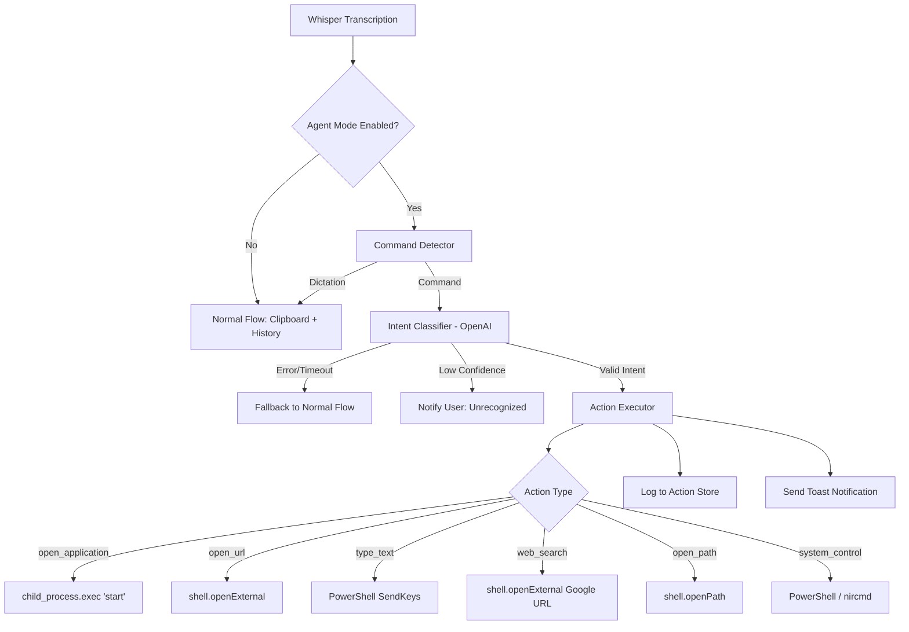
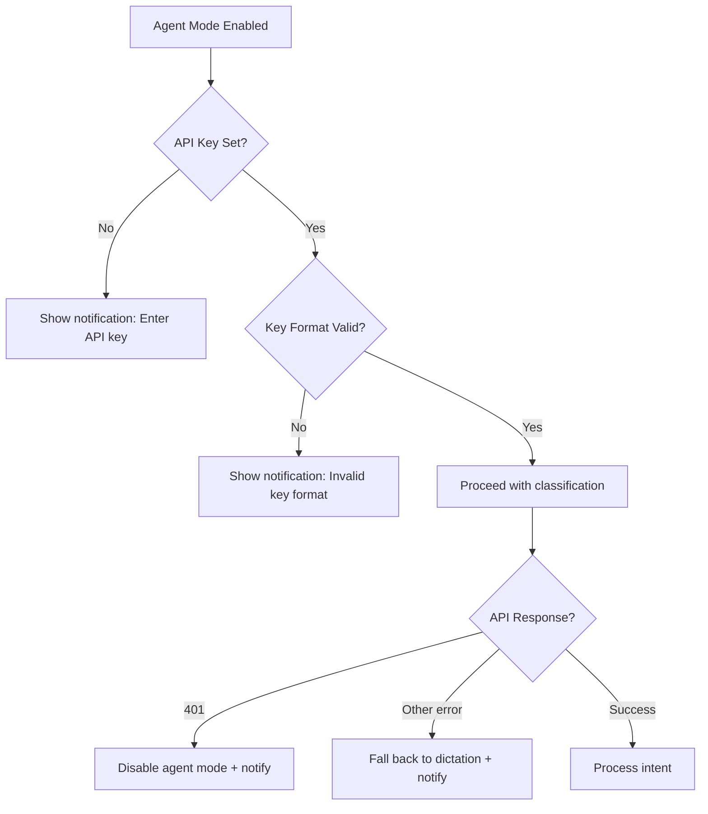

# Design Document: Voice AI Agent

## Overview

This feature extends the existing Voice-to-Text Electron application with an AI agent layer that intercepts transcribed speech, detects commands, classifies intent via OpenAI GPT-4o-mini, and executes system actions. The architecture adds four new main-process modules (`agent-service.ts`, `command-detector.ts`, `intent-classifier.ts`, `action-executor.ts`) that integrate into the existing transcription pipeline. The agent intercepts text in the `TRANSCRIBE` IPC handler after Whisper returns results, routing commands through the AI pipeline while passing dictation through the existing clipboard/history flow unchanged.

The design prioritizes:
- **Zero-latency for dictation**: Command detection is local (regex/keyword), so non-command text flows through instantly
- **Graceful degradation**: API failures fall back to treating text as dictation
- **No native dependencies**: All system actions use PowerShell/child_process or Electron shell APIs
- **Minimal coupling**: The agent pipeline is a separate layer that can be toggled off entirely

## Architecture



### Integration Point

The agent hooks into the existing `TRANSCRIBE` IPC handler in `main.ts`. After `whisperService.transcribe()` returns text, the agent service is invoked:

```typescript
// In TRANSCRIBE handler, after whisper returns result:
if (agentEnabled && result.text) {
  const agentResult = await agentService.process(result.text);
  if (agentResult.handled) {
    // Command was executed — skip normal clipboard/history flow
    return result;
  }
}
// Otherwise, continue with normal clipboard copy + history entry
```

## Components and Interfaces

### 1. AgentService (`src/main/agent/agent-service.ts`)

The orchestrator module that coordinates the pipeline.

```typescript
export interface AgentResult {
  handled: boolean;
  action?: ActionLogEntry;
  error?: string;
}

export class AgentService {
  constructor(
    private commandDetector: CommandDetector,
    private intentClassifier: IntentClassifier,
    private actionExecutor: ActionExecutor,
    private agentStore: AgentStore,
    private notifier: AgentNotifier
  ) {}

  async process(text: string): Promise<AgentResult>;
  isEnabled(): boolean;
  setEnabled(enabled: boolean): void;
  setApiKey(key: string): void;
}
```

### 2. CommandDetector (`src/main/agent/command-detector.ts`)

Local regex/keyword-based detection — no API call needed.

```typescript
export interface DetectionResult {
  isCommand: boolean;
  confidence: number;
  matchedPattern?: string;
}

export class CommandDetector {
  detect(text: string): DetectionResult;
}
```

**Detection Strategy:**
- Matches imperative verb patterns at the start of text: `open`, `go to`, `type`, `search`, `mute`, `unmute`, `volume`, `take screenshot`, `launch`, `close`, `find`, `navigate`
- Short utterances (< 5 words) with action verbs are more likely commands
- Longer utterances without action verb prefixes are classified as dictation
- Uses a weighted scoring system combining pattern match + length heuristic

### 3. IntentClassifier (`src/main/agent/intent-classifier.ts`)

Sends command text to OpenAI GPT-4o-mini for structured classification.

```typescript
export interface ClassifiedIntent {
  action: ActionType;
  target: string;
  confidence: number;
  parameters?: Record<string, unknown>;
}

export interface ClassificationError {
  type: 'timeout' | 'network' | 'invalid_key' | 'api_error' | 'parse_error';
  message: string;
  httpStatus?: number;
}

export type ClassificationResult =
  | { success: true; intent: ClassifiedIntent }
  | { success: false; error: ClassificationError };

export type ActionType =
  | 'open_application'
  | 'open_url'
  | 'type_text'
  | 'web_search'
  | 'open_path'
  | 'system_control';

export class IntentClassifier {
  constructor(private apiKey: string) {}

  async classify(commandText: string): Promise<ClassificationResult>;
  setApiKey(key: string): void;
}
```

**OpenAI Integration:**
- Uses the `openai` npm package
- Model: `gpt-4o-mini`
- Response format: JSON mode (`response_format: { type: "json_object" }`)
- Timeout: 10 seconds (AbortController)
- System prompt instructs the model to return `{ action, target, confidence, parameters }`

### 4. ActionExecutor (`src/main/agent/action-executor.ts`)

Executes classified intents using platform-appropriate methods.

```typescript
export interface ExecutionResult {
  success: boolean;
  action: ActionType;
  target: string;
  error?: string;
  durationMs: number;
}

export class ActionExecutor {
  async execute(intent: ClassifiedIntent): Promise<ExecutionResult>;
}
```

**Execution Methods by Action Type:**

| Action Type | Method |
|---|---|
| `open_application` | `child_process.exec('start "" "app"')` with app name mapping |
| `open_url` | `shell.openExternal(url)` — prepends `https://` if no protocol |
| `type_text` | PowerShell: `Add-Type` + `[System.Windows.Forms.SendKeys]::SendWait()` |
| `web_search` | `shell.openExternal('https://www.google.com/search?q=...')` |
| `open_path` | `shell.openPath(resolvedPath)` — resolves aliases like "documents" |
| `system_control` | PowerShell for volume/mute (audio COM objects), `ms-screenclip:` for screenshot |

### 5. AgentStore (`src/main/agent/agent-store.ts`)

Persists the action log using electron-store.

```typescript
export interface ActionLogEntry {
  id: string;
  timestamp: number;
  commandText: string;
  intentType: ActionType;
  target: string;
  status: 'success' | 'error';
  errorMessage?: string;
  durationMs: number;
}

export class AgentStore {
  addEntry(entry: ActionLogEntry): void;
  getEntries(): ActionLogEntry[];
  clearLog(): void;
}
```

### 6. AgentNotifier

Sends toast notifications to the dashboard/widget renderer.

```typescript
export interface AgentNotifier {
  notifySuccess(message: string): void;
  notifyError(message: string): void;
  notifyUnrecognized(commandText: string): void;
}
```

Implemented by sending IPC messages to the dashboard window's `webContents`.

### IPC Channel Extensions

New channels added to `IpcChannel` enum:

```typescript
// Agent-related IPC channels
AGENT_GET_LOG = 'agent-get-log',
AGENT_CLEAR_LOG = 'agent-clear-log',
AGENT_TOAST = 'agent-toast',
AGENT_ACTION_RESULT = 'agent-action-result',
```

### Preload API Extensions

New methods exposed to the renderer:

```typescript
// Agent API additions
getAgentLog(): Promise<ActionLogEntry[]>;
clearAgentLog(): Promise<void>;
onAgentToast(callback: (toast: ToastMessage) => void): void;
```

## Data Models

### Settings Extensions

The existing `Settings` interface is extended:

```typescript
// Added to Settings interface in shared/types.ts
export interface Settings {
  // ... existing fields ...
  aiAgentEnabled: boolean;
  openaiApiKey: string;  // Stored obfuscated via base64 encoding in electron-store
}
```

Default values:
- `aiAgentEnabled`: `false`
- `openaiApiKey`: `''`

### ActionLogEntry

```typescript
export interface ActionLogEntry {
  id: string;              // UUID v4
  timestamp: number;       // Date.now() epoch ms
  commandText: string;     // Original transcribed text
  intentType: ActionType;  // Classified action type
  target: string;          // Action target (app name, URL, text, etc.)
  status: 'success' | 'error';
  errorMessage?: string;   // Present when status is 'error'
  durationMs: number;      // Total pipeline duration
}
```

### ClassifiedIntent (OpenAI Response Schema)

```typescript
export interface ClassifiedIntent {
  action: ActionType;
  target: string;
  confidence: number;       // 0.0 - 1.0
  parameters?: {
    [key: string]: unknown; // Additional context (e.g., volume level, delay)
  };
}
```

### ToastMessage

```typescript
export interface ToastMessage {
  type: 'success' | 'error' | 'warning';
  message: string;
  autoDismissMs: number;   // Default: 4000
}
```

### Application Name Mapping

```typescript
const APP_NAME_MAP: Record<string, string> = {
  'chrome': 'chrome',
  'google chrome': 'chrome',
  'firefox': 'firefox',
  'notepad': 'notepad',
  'calculator': 'calc',
  'spotify': 'spotify',
  'vscode': 'code',
  'visual studio code': 'code',
  'file explorer': 'explorer',
  'explorer': 'explorer',
  'word': 'winword',
  'excel': 'excel',
  'powerpoint': 'powerpnt',
  'terminal': 'wt',
  'command prompt': 'cmd',
  // ... extensible
};
```

### Folder Alias Mapping

```typescript
const FOLDER_ALIASES: Record<string, string> = {
  'documents': path.join(os.homedir(), 'Documents'),
  'my documents': path.join(os.homedir(), 'Documents'),
  'downloads': path.join(os.homedir(), 'Downloads'),
  'desktop': path.join(os.homedir(), 'Desktop'),
  'pictures': path.join(os.homedir(), 'Pictures'),
  'music': path.join(os.homedir(), 'Music'),
  'videos': path.join(os.homedir(), 'Videos'),
};
```

## Correctness Properties

*A property is a characteristic or behavior that should hold true across all valid executions of a system — essentially, a formal statement about what the system should do. Properties serve as the bridge between human-readable specifications and machine-verifiable correctness guarantees.*

### Property 1: Action verb prefix implies command classification

*For any* text string that begins with a known action verb (open, go to, type, search, mute, unmute, volume, take, launch, close, find, navigate), the CommandDetector SHALL classify it as a command (isCommand = true).

**Validates: Requirements 1.2**

### Property 2: Disabled agent mode passes all text through

*For any* transcribed text string, when AI agent mode is disabled, the AgentService SHALL return `handled = false` without invoking the CommandDetector or IntentClassifier.

**Validates: Requirements 1.5, 10.2**

### Property 3: Agent routing correctness

*For any* transcribed text when agent mode is enabled: if the CommandDetector classifies it as dictation, the IntentClassifier SHALL NOT be invoked; if the CommandDetector classifies it as a command, the IntentClassifier SHALL be invoked with that text.

**Validates: Requirements 1.3, 1.4**

### Property 4: API error fallback to dictation

*For any* classification error returned by the IntentClassifier (timeout, network, API error, parse error), the AgentService SHALL return `handled = false` so the text flows through the normal dictation pipeline.

**Validates: Requirements 13.4**

### Property 5: Intent JSON parsing round-trip

*For any* valid ClassifiedIntent object (with valid action type, non-empty target, confidence in [0,1], and optional parameters), serializing it to JSON and parsing it back through the intent parser SHALL produce an equivalent object.

**Validates: Requirements 2.2, 14.3**

### Property 6: Invalid JSON produces parse error

*For any* string that is not valid JSON, or valid JSON that is missing required fields (action, target, confidence), the intent response parser SHALL return a `parse_error` classification error.

**Validates: Requirements 2.4, 14.2**

### Property 7: Extra fields in response are ignored

*For any* valid intent JSON response that also contains additional unknown fields, the intent parser SHALL extract only the known schema fields (action, target, confidence, parameters) and produce a valid ClassifiedIntent, ignoring the extra fields.

**Validates: Requirements 14.4**

### Property 8: Confidence threshold enforcement

*For any* ClassifiedIntent with a confidence score below 0.7, the AgentService SHALL NOT execute the action and SHALL notify the user that the command was unrecognized.

**Validates: Requirements 2.5**

### Property 9: URL protocol normalization is idempotent

*For any* URL string, applying the protocol normalization function (prepend "https://" if no protocol) twice SHALL produce the same result as applying it once. Additionally, the output SHALL always start with a valid protocol prefix (http:// or https://).

**Validates: Requirements 4.2**

### Property 10: Search URL encoding round-trip

*For any* search query string, constructing the Google search URL with URL-encoded query and then extracting and decoding the query parameter from the resulting URL SHALL yield the original search query string.

**Validates: Requirements 6.1, 6.2**

### Property 11: Folder alias resolution produces valid home-relative paths

*For any* known folder alias key, the resolved path SHALL start with `os.homedir()` and SHALL end with the expected folder name segment.

**Validates: Requirements 7.2**

### Property 12: API key format validation

*For any* string, the API key validator SHALL return true if and only if the string starts with "sk-" and has a length of at least 20 characters.

**Validates: Requirements 9.2**

### Property 13: API key storage obfuscation and round-trip

*For any* valid API key string, storing it through the settings store and retrieving it SHALL yield the original key (round-trip), AND the raw value persisted in the store SHALL NOT equal the plain-text key (obfuscation).

**Validates: Requirements 9.1**

### Property 14: Action log completeness and ordering

*For any* sequence of action execution results (success or error), the AgentStore SHALL contain an entry for each result with all required fields populated, and `getEntries()` SHALL return them in reverse chronological order (most recent first).

**Validates: Requirements 11.2, 11.3**

## Error Handling

### Error Categories and Responses

| Error Source | Error Type | Response |
|---|---|---|
| OpenAI API | Timeout (>10s) | Abort request, return timeout error, fall back to dictation |
| OpenAI API | HTTP 401 | Disable agent mode, notify user to check API key |
| OpenAI API | HTTP 4xx/5xx | Return error with status code, fall back to dictation |
| OpenAI API | Network unreachable | Return network error, notify user, fall back to dictation |
| OpenAI API | Invalid JSON response | Return parse error, fall back to dictation |
| Action Executor | App not found | Return error status, log to action log, show error toast |
| Action Executor | shell.openExternal fails | Return error status, log to action log, show error toast |
| Action Executor | PowerShell exec fails | Return error status, log to action log, show error toast |
| Action Executor | Path not found | Return error status, log to action log, show error toast |
| Command Detector | Unexpected error | Log error, treat text as dictation (safe fallback) |

### Fallback Strategy

The core principle is **never lose the user's speech**. If any part of the agent pipeline fails:
1. The transcribed text is treated as plain dictation
2. Normal clipboard copy and history entry occur
3. The user is notified of the failure via toast

### API Key Validation Flow



### Timeout Configuration

- **Command Detection**: Must complete within 50ms (local regex, no network)
- **Intent Classification**: 10-second timeout via AbortController
- **Action Execution**: 5-second timeout for child_process operations
- **Toast Notifications**: Auto-dismiss after 4 seconds

## Testing Strategy

### Property-Based Testing

This feature is well-suited for property-based testing because it contains multiple pure functions with clear input/output behavior (command detection, intent parsing, URL construction, path resolution, validation logic).

**Library**: `fast-check` (TypeScript property-based testing library)

**Configuration**:
- Minimum 100 iterations per property test
- Each test tagged with: `Feature: voice-ai-agent, Property {number}: {property_text}`

**Properties to implement** (from Correctness Properties section):
1. Command detection verb matching
2. Disabled mode pass-through
3. Agent routing correctness
4. API error fallback
5. Intent JSON round-trip
6. Invalid JSON error handling
7. Extra fields tolerance
8. Confidence threshold
9. URL protocol idempotence
10. Search URL encoding round-trip
11. Folder alias resolution
12. API key validation
13. API key obfuscation round-trip
14. Action log completeness and ordering

### Unit Tests (Example-Based)

Focus on specific scenarios and edge cases:
- Each of the 6 action types accepted by the parser (Req 2.3)
- App launch failure returns error (Req 3.3)
- Malformed URL returns error (Req 4.3)
- Keyboard simulation failure returns error (Req 5.3)
- Browser open failure returns error (Req 6.3)
- Non-existent path returns error (Req 7.3)
- System control failure returns error (Req 8.5)
- No API key + agent enabled → notification (Req 9.3)
- 401 response → disable agent mode (Req 13.5)
- Toast auto-dismiss is 4000ms (Req 12.4)
- Clear log empties all entries (Req 11.5)

### Integration Tests

- OpenAI API call structure (correct model, system prompt, response_format) (Req 2.1)
- API timeout behavior with mocked slow responses (Req 13.1)
- Network error handling (Req 13.3)
- Settings hot-reload (API key update without restart) (Req 9.4)
- System control PowerShell commands (Req 8.1-8.4)
- Full pipeline: transcription → detection → classification → execution (end-to-end with mocks)

### Test File Organization

```
apps/electron/src/__tests__/
├── agent/
│   ├── command-detector.test.ts        # Unit + property tests
│   ├── intent-classifier.test.ts       # Unit + property tests
│   ├── action-executor.test.ts         # Unit + integration tests
│   ├── agent-service.test.ts           # Unit + property tests
│   ├── agent-store.test.ts             # Unit + property tests
│   └── properties/
│       └── agent-properties.test.ts    # All 14 property-based tests
```

