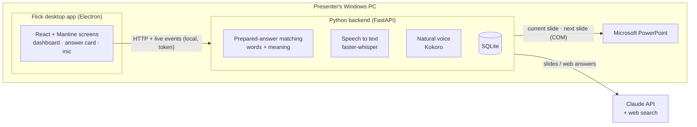

# Flick: an AI teacher for your presentations

> **Capital Youth Expo Hackathon 2026 · Track 1: Education (EdTech)**

Flick sits next to your PowerPoint. It **answers the audience's questions out loud in seconds**, **explains any slide like a teacher** (with real-life examples and drawings on a whiteboard), and can even **give the whole talk for you**. In **English, Urdu, or the Urdu-English mix** that Pakistani classrooms actually speak. Students also use it to **study** a teacher's slides before an exam.

Built for university classrooms: students presenting projects, and teachers who would otherwise say *"I'll find out and tell you next class."*

| | |
|---|---|
| **Download (Windows 10/11)** | [**Flick-Setup.exe** from the latest release](https://github.com/AHMADMALIK1376/Flick/releases/latest) |
| **Demo video (2 min)** | _link added at submission_ |
| **Pitch deck** | _link added at submission_ |

**No web deployment:** Flick is a **Windows desktop app** (it controls PowerPoint and runs speech and voice on the computer), so there is no website to host. Judges can install it with the installer above, or run it from source (below).

## The problem

Live Q&A is the hardest part of presenting. A question you didn't expect breaks your flow, and "I'll get back to you" loses the room. Students lose marks; teachers lose time. Searching on your phone in front of the class isn't an option.

## How Flick works

**Before the talk.** Load your PowerPoint. Flick reads every slide and speaker note, **predicts the questions your audience will probably ask** and prepares an answer for each. It also writes a short spoken explanation for every slide. Review them on the **Prepared Questions** page: it doubles as rehearsal.

**During the talk.** Press **Ctrl+Shift+Space** (or click the floating mic), say *"Flick, …"* and repeat the question. Flick turns your voice into text **on your computer**, then answers from the fastest source that knows:

| | Source | Typical speed |
|---|---|---|
| 1 | **Prepared answer**: matches a predicted question, by words or by meaning | ~0.02 s |
| 2 | **Your slides**: Claude answers from the deck and speaker notes | ~2–3 s |
| 3 | **The web**: Claude searches and answers with sources | ~5–7 s |

The floating answer card shows **where the answer came from** (*Prepared answer*, *From your slides*, *From the web*), so you know how far to trust it. Flick speaks the answer sentence by sentence while it is still being written, so the room never waits in silence.

**Ask the way you speak.** The mic shows *Listening…*, then your words appear live as you talk. When you stop, it waits: fix a word by typing, press **✓** (or Enter) to ask, or **✕** to drop it. Left alone for 20 seconds, it closes by itself.

**"Flick, explain this slide"** (or **Ctrl+Shift+E**): Flick knows which slide is on screen (it connects to Microsoft PowerPoint) and explains it to the audience out loud, with examples.

**Commands, not just questions.** Flick tells a question from a request. *"Go back to slide 6 and explain it again with an example"*: it moves PowerPoint to slide 6, explains it a new way (and draws the example), says *"Now, back to slide 8"*, and carries on. *"Go to slide 3"* just moves there. If no slide number is given (*"go over the security part again"*), Flick works out which slide is meant.

**"Present for me."** Tired, or need a hand? Press **Present for me** (or say *"Flick, present this for me"*). Flick runs the PowerPoint slide show and **gives the whole talk itself**: it explains every slide to the class in a **natural human voice**, and moves to the next slide on its own. It talks **like a teacher, not a slide reader**: it explains *why* before *how*, starts from what students already know, uses one vivid local example (a chai dhaba, a cricket team, a bank queue), asks the class a question and answers it, and links each slide to the last. When a student has a question, press the Ask hotkey: Flick **stops mid-sentence, listens, answers, and picks up where it left off**. Pause, next, previous and stop work any time, from the app, the floating card or by voice.

**A smart whiteboard.** When an idea is hard to picture (a process, how parts relate, a comparison), Flick **draws it on a full-screen whiteboard while it explains**, step by step, in a hand-drawn style with everyday characters. It decides by itself: no drawing for a title or a simple list. Every mode also has a **Whiteboard** option: *only when needed*, *draw every slide*, or *a real-life example on every slide*. Ask *"draw this"*, *"give me an example"* or *"explain it with a story"* and it always draws.

**Three languages.** Pick **English**, **Urdu**, or **Urdu + English** (mixed inside the same sentence, the way teachers in Pakistan explain in class). Flick explains, answers and narrates its drawings in that language, with an Urdu voice that runs offline (two female, two male).

**Study mode for students.** Teachers share slides before exams, and reading them all is a lot. On the **Study** page a student gives Flick the deck and picks how to learn it:

| Mode | How Flick explains |
|---|---|
| **Story mode** | One continuing story with everyday characters (Ali, Sara, the chai dhaba); each slide is the next scene |
| **Professional mode** | Precise, with the right technical terms, a real industry example and the classic mistake to avoid |
| **Exam mode** | Key points, definitions, a memory trick, and a likely exam question with a short model answer |
| **Visual mode** | Every idea explained through a real-life example drawn step by step on the whiteboard |

In a study session Flick talks **one-on-one, like a friend who understands the topic**, slide by slide, and the student can stop it any time to ask a question, or tap **Draw this**, **Give an example**, **Tell it as a story** or **Simpler, please**. Teachers can use the same modes for "Present for me".

**Token Analyzer.** Every Claude call is counted with its cost: a card per presentation or study session (with its mode and language), per slide explained, for questions and for preparation. Click a card and it opens to show where the tokens went (slide talk, drawings, examples, questions) and slide by slide. **Choose the model** (Claude Haiku 5.5, Sonnet 5.5 or Opus 5.5) from the sidebar in one click.

**After the talk.** The **Q&A Log** keeps every question, answer and web source. Export it as CSV.

### Highlights

- **Gives the whole talk for you**, slide by slide, pausing for questions, and moves PowerPoint itself
- **Talks like a teacher**, not a text-to-speech of the slides; explains a slide a *new* way when asked again
- **A natural, human-sounding voice that runs offline** (no extra API key): 4 English and 4 Urdu voices, adjustable speed, steady pacing without long pauses
- **More prepared questions for harder decks**: 2 to 8 per slide depending on how dense it is (100–200 for a complex deck)
- **English, Urdu, or Urdu + English mixed**, chosen in one click
- **Costs shown, not hidden**: the Token Analyzer prices every presentation, slide and question
- **Private speech**: speech recognition runs on your computer; only the question text goes to the AI
- **Stays on top of the slide show** and never steals focus from PowerPoint, so your clicker keeps working
- **Speak to the room, or show only to me**: a private prompt when you'd rather answer yourself
- **Never says an error out loud**: problems show quietly on your screen
- **Your own key**: each user adds their own Claude API key in Settings

## How it's built



| Part | Folder | Tech |
|---|---|---|
| Backend: all AI, matching, speech to text, database | `backend/` | Python 3.12, FastAPI, SQLite |
| Screens | `apps/ui/` | React 19, TypeScript, Mantine 9, Vite |
| Desktop app: starts the backend, windows, global hotkeys, voice | `apps/electron/` | Electron |

The backend only listens on `127.0.0.1` and needs a random per-launch token, so no other program can use it.

## Run it (Windows)

**Easiest:** download and run [**Flick-Setup.exe**](https://github.com/AHMADMALIK1376/Flick/releases/latest) (no Python or Node needed). Windows may show *"Windows protected your PC"* because the installer isn't code-signed: click **More info → Run anyway**. Microsoft PowerPoint is needed for "Present for me" and "explain this slide"; the Study page works without it.

**From source** needs **Python 3.12**, **Node.js 22**, and a Claude API key from [console.anthropic.com](https://console.anthropic.com).

```powershell
git clone https://github.com/AHMADMALIK1376/Flick.git
cd Flick

cd backend;      pip install -r requirements.txt;  cd ..
cd apps\ui;      npm install;  npm run build;      cd ..\..
cd apps\electron; npm install;  npm start
```

Flick starts its backend by itself. On first start it downloads the speech and voice models (about 800 MB, once; needs internet that first time). Then follow the on-screen setup: allow the microphone, paste your Claude key, load a `.pptx`.

Developing? See `apps/ui/README.md` (screens with live reload), `backend/README.md` (API) and `CONTRIBUTING.md` (team workflow).

### Tests

```powershell
cd backend;        python -m pytest -q
cd apps\ui;        npm run typecheck; npm test; npm run build
cd apps\electron;  npx tsc --noEmit;  npm test
```
GitHub Actions runs all three on every pull request.

## External APIs, models and libraries

Disclosed as required by the competition rules.

**APIs and services**
- **Anthropic Claude API** (Messages API, with the server-side **web search** tool and prompt caching): predicts questions, answers from slides and the web, writes slide explanations, study lessons and whiteboard drawings, and routes slide commands. Default model Claude Haiku 5.5; Sonnet 5.5 / Opus 5.5 selectable. Each user provides their own API key.
- **Microsoft PowerPoint** (COM automation via pywin32, read-only): which slide is on screen, and the open presentation.
- **Windows speech voices** (through the browser Speech Synthesis API in Electron): fallback voice when the natural voice is off.

**On-device AI models** (downloaded on first run)
- **OpenAI Whisper** speech-to-text, run with **faster-whisper** (CTranslate2), size `small` by default
- **paraphrase-multilingual-MiniLM-L12-v2** sentence embeddings (via **fastembed**) for matching questions by meaning
- **Kokoro-82M** text-to-speech (Apache-2.0), run with **kokoro-onnx** and **espeak-ng** (via espeakng-loader, GPL-3.0) for pronunciation: Flick's natural voice. English voices for English; Kokoro's Hindi voices with espeak-ng's **Urdu** pronunciation for Urdu and Urdu + English

**Backend libraries (Python)**: FastAPI, Uvicorn, Pydantic, anthropic (SDK), python-pptx, python-multipart, NumPy, fastembed, faster-whisper, kokoro-onnx, phonemizer, espeakng-loader, pywin32; tests: pytest, pytest-asyncio, httpx.

**Frontend libraries**: React, React Router, Mantine (core, hooks, notifications, dropzone), Tabler Icons, Plus Jakarta Sans and Caveat fonts (Fontsource); build and tests: Vite, TypeScript, Vitest, Testing Library, PostCSS.

**Desktop**: Electron, electron-builder (NSIS installer); tests: Vitest. **Installer build**: PyInstaller, GitHub Actions.

**AI coding assistants**: the team used **Claude** (Anthropic) and **DeepSeek** to help write code, tests and documentation. All code was reviewed and tested by the team.

## Project history (originality)

- This repository was created in **July 2026** for an earlier, unrelated experiment (a PC-control agent and an old web app). **None of that code is part of Flick**: it was removed during the build window and remains only in the git history.
- **All Flick code was written during the competition build window (Nov 16 – 28, 2026)**, starting **Nov 20**. The full history is in the commits and pull requests.
- Flick is also our semester project for **CSC332 (Advanced DBMS)**.

## Team

| | Role |
|---|---|
| **Ahmad Malik** | Lead: AI, backend, desktop app |
| **Muhammad Mehdi Kazmi** | Frontend and backend features |
| **Abdullah** | Pitch, demo video, documentation |

BSCS students, Fall 2026.

## License

MIT. See `LICENSE`.
